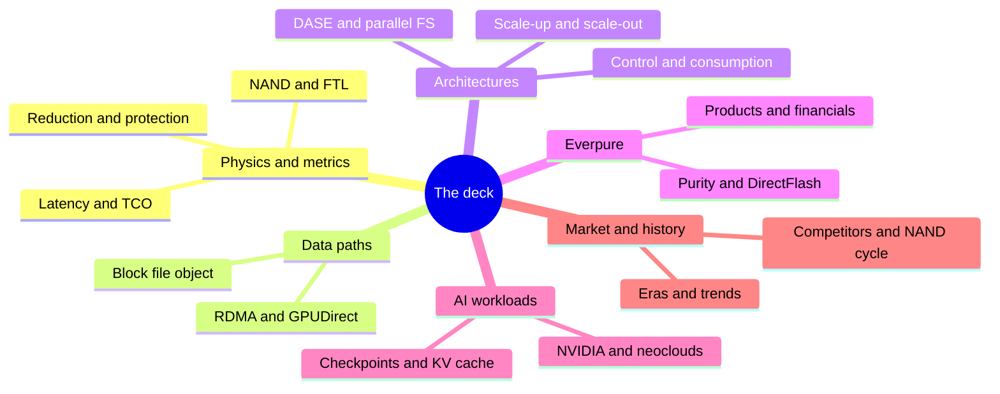
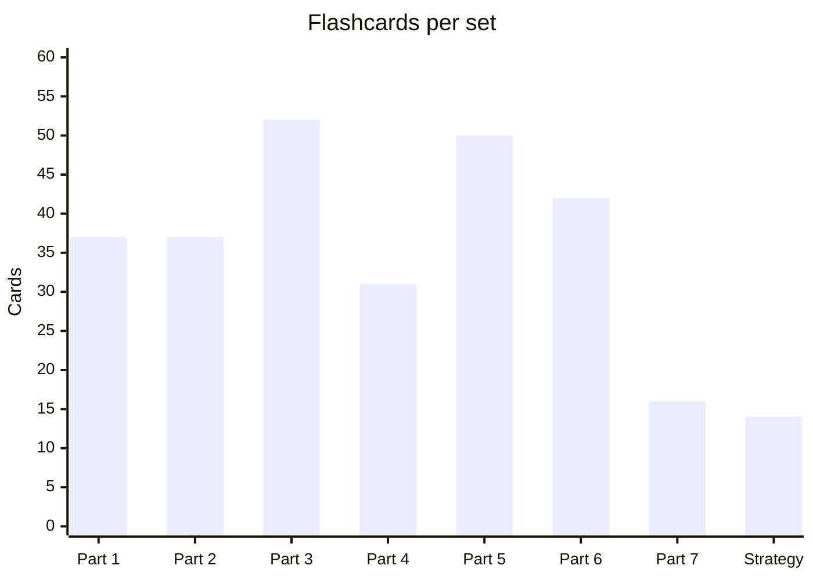
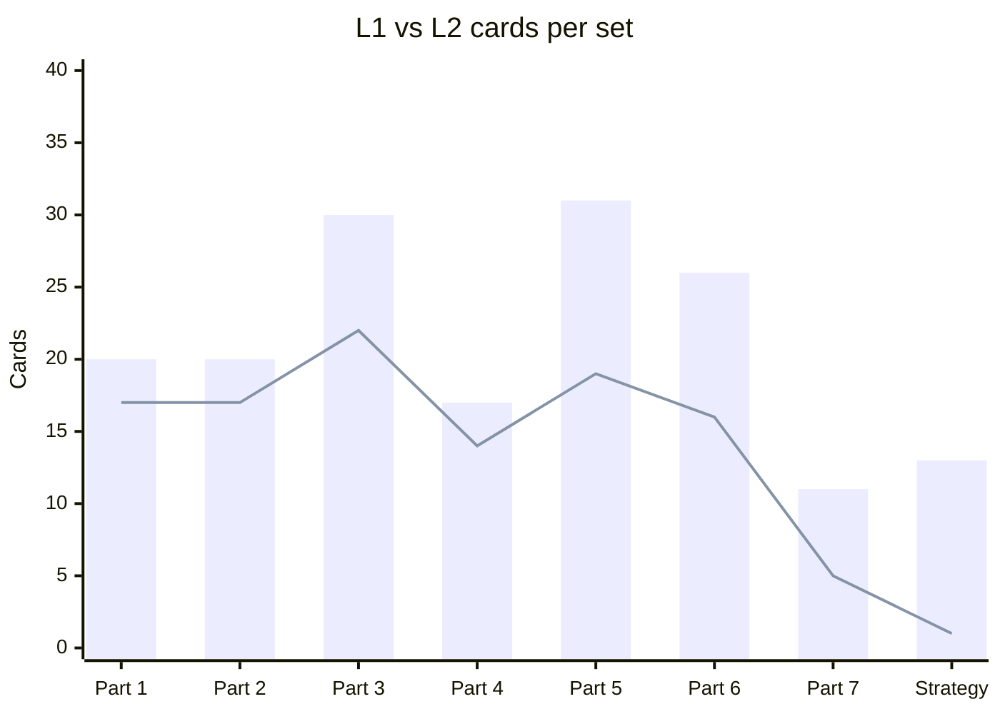
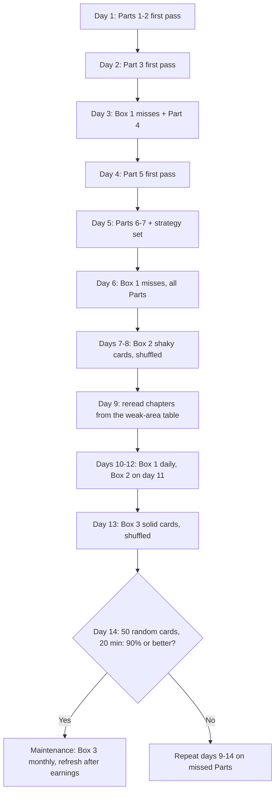
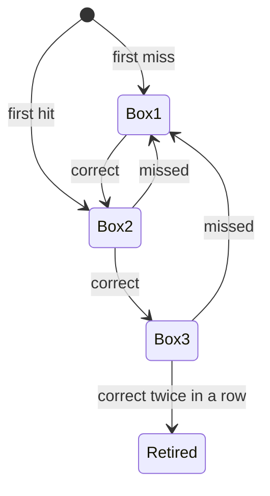

# 59. Self-test: 200 flashcards

> **Depth:** L1–L2 · **Reading time:** ~54 min · **Last verified:** 2026-11-01
> **Prerequisites:** None to start, but the deck pays off most after a first pass through Parts 1–7. Begin with [What storage does](../01-storage-fundamentals/01-what-storage-does.md); pair it with the [Question bank](57-question-bank.md) and [Explain it in 30 seconds](58-explain-in-30-seconds.md).

## TL;DR

- **This chapter is a deck, not a reading.** 279 cards (Q1–Q279), one per `
` block, grouped by Part plus a mixed strategy set. Read the question, say the answer out loud, then click to check.
- **Two depths.** 111 untagged L1 cards test vocabulary ("can you define it?"); 168 cards tagged "(L2)" test mechanism and trade-off ("can you say why?"). Credibility with engineers comes from the L2 cards.
- **Use spaced repetition, not rereading.** Sort cards into three boxes: missed (review daily), shaky (every three days), solid (weekly). A card moves up a box when you get it right and back to box 1 when you miss it.
- **Two weeks gets you conversation-ready.** The schedule below covers every card in the first five days, then spends nine days on misses, interleaved Parts and a timed 50-card mixed test.
- **Misses are a map.** Every answer ends with the chapter it came from. Three misses from one chapter mean reread that chapter, not drill the cards.

## Why this matters for Everpure strategy

A strategy hire is judged in the first few meetings by whether they can follow a PM or an engineer without stopping them for definitions. Product managers talk in Evergreen tiers, R-generations, Fusion presets and STaaS TCV. Engineers talk in write amplification, ANA paths, erasure-code geometry and KV-cache tiers. The Office of the CTO talks in trade-offs: why DirectFlash beats FDP SSDs, why EXA uses pNFS instead of a proprietary client, why a 300 TB module changes rebuild risk. Recognising a term is not the same as being able to use it under time pressure, and these cards train recall, which is the skill a meeting tests.

The deck also guards against the most expensive mistake an outsider can make: repeating a vendor claim as fact. Many L2 cards end with a qualifier, such as "company-stated", "against a no-cache baseline" or "in a round the strongest rivals skipped". The point is to remember the claim and its caveat together, which is how Everpure's own engineers will talk about VAST, WEKA and DDN, and how they expect a strategy colleague to talk about Everpure.

## Core concepts

### How the deck is built

Every card was written from the chapter it links to: its TL;DR, its core-concept explanations and its "Numbers that matter" table. No card adds a fact the atlas does not already contain. Where a chapter labels a figure *company-stated*, *worked example* or *illustrative*, the card keeps the label. Numbers are therefore only as current as the atlas's last-verified date (2026-11-01). Financial, market-share and benchmark cards go stale fastest (see History and trajectory).

The split is roughly 40% L1 and 60% L2. An L1 card has one right answer, usually a definition or a list. An L2 card asks *why* or *what follows*, and a good answer names a mechanism, a number and a consequence. Score yourself strictly on L2: an answer that gets the mechanism right but not the consequence counts as a miss.

*Figure 59.1 — What the deck tests: six clusters of mental models, each mapped to one or two Parts of the atlas.*

| Set | Cards | L1 | L2 | L2 share | Card numbers |
|---|---|---|---|---|---|
| Part 1 — Storage fundamentals | 37 | 17 | 20 | 54% | Q1–Q37 |
| Part 2 — Protocols and networking | 37 | 17 | 20 | 54% | Q38–Q74 |
| Part 3 — System architecture | 52 | 22 | 30 | 58% | Q75–Q126 |
| Part 4 — Everpure | 31 | 14 | 17 | 55% | Q127–Q157 |
| Part 5 — AI storage | 50 | 19 | 31 | 62% | Q158–Q207 |
| Part 6 — Industry and competition | 42 | 16 | 26 | 62% | Q208–Q249 |
| Part 7 — History and future | 16 | 5 | 11 | 69% | Q250–Q265 |
| Strategy mix | 14 | 1 | 13 | 93% | Q266–Q279 |
| **Total** | **279** | **111** | **168** | **60%** | Q1–Q279 |

*Figure 59.2 — The deck leans toward the architecture, AI and competition Parts, where conversations with Everpure PMs and engineers spend most of their time.*

*Figure 59.3 — Card counts follow chapter counts: Part 3 (twelve chapters) and Part 5 (ten) carry the most cards; the strategy set is small but every card in it crosses Parts.*

*Figure 59.4 — L2 cards outnumber L1 cards in every set, most of all in the strategy mix, where almost every card is a trade-off.*

### Scoring an L2 answer

L1 cards are right or wrong. L2 cards need a rubric, because a half-right answer is the kind that sounds fine in a meeting and fails under one follow-up question.

| Element | Full credit | Partial credit | Example |
|---|---|---|---|
| Mechanism | Names the cause, e.g. "decode rereads the whole cache per token" | Names the topic only, e.g. "KV is big" | Q170 |
| Number | Gives the chapter's figure with its unit and basis | Right order of magnitude, wrong basis | Q163 |
| Consequence | Says what it means for a buyer or for Everpure | Stops at the mechanism | Q134 |
| Qualifier | Keeps "company-stated", "illustrative" or "among entrants" | Drops the caveat | Q143 |

*Figure 59.5 — An L2 card counts as correct only with all four elements; without the consequence or the qualifier, score it as a miss and move it back to box 1.*

### A two-week review schedule

The schedule front-loads breadth (every card seen once by day 5) and then shifts to retrieval of what you missed. Interleaving, mixing cards from different Parts in one sitting, feels harder than drilling one Part, and that difficulty is the point: in a meeting, questions arrive in no particular order.

*Figure 59.6 — A suggested 14-day plan: five days of first passes, nine days of spaced, interleaved retrieval, ending in a timed mixed test.*

The box rules are simple enough to run with a pen and the card numbers:

*Figure 59.7 — Leitner-style boxes: a miss always sends a card back to daily review, so effort concentrates where recall is weakest.*

### Diagnosing weak areas

Score by Part, not just in total. A miss cluster usually points to one missing mental model, and rereading the chapter that builds it is faster than drilling the cards that depend on it.

| If you keep missing… | The missing model is… | Reread first | Then |
|---|---|---|---|
| WAF, OP, indirection units, log-on-log | How an FTL works | [Ch 3](../01-storage-fundamentals/03-inside-an-ssd.md) | [Ch 26](../04-everpure/26-purity-and-directflash.md) |
| p99, Little's law, raw vs effective TB | Performance and capacity arithmetic | [Ch 4](../01-storage-fundamentals/04-performance-and-economics-metrics.md) | [Ch 5](../01-storage-fundamentals/05-data-reduction.md) |
| NVMe/TCP vs RoCE, PFC, incast | Transport and congestion | [Ch 7](../02-protocols-and-networking/07-block-protocols.md) | [Ch 10](../02-protocols-and-networking/10-datacenter-networking.md) |
| pNFS, layouts, single-head NAS | Control path vs data path | [Ch 8](../02-protocols-and-networking/08-file-protocols.md) | [Ch 17](../03-system-architecture/17-parallel-file-systems.md) |
| DASE vs shared-nothing vs EXA | Where state lives | [Ch 16](../03-system-architecture/16-disaggregated-shared-everything.md) | [Ch 15](../03-system-architecture/15-scale-out-shared-nothing.md), [Ch 27](../04-everpure/27-flasharray-and-flashblade.md) |
| Quorums, durability nines, rebuild windows | Failure maths | [Ch 20](../03-system-architecture/20-distributed-systems-fundamentals.md) | [Ch 6](../01-storage-fundamentals/06-data-protection-and-resilience.md) |
| ARR, RPO, TCV, ratable revenue, GM | Subscription accounting | [Ch 23](../03-system-architecture/23-consumption-models.md) | [Ch 29](../04-everpure/29-hyperscaler-ecosystem-financials.md) |
| Checkpoint sizing, restore storms | Training failure economics | [Ch 31](../05-ai-storage/31-training-storage.md) | [Ch 11](../02-protocols-and-networking/11-gpu-data-path.md) |
| KV per token, recompute vs fetch, G1–G4 | Inference memory hierarchy | [Ch 32](../05-ai-storage/32-inference-and-kv-cache.md) | [Ch 53](../07-history-and-future/53-future-trends.md) |
| MLPerf AU, hero configs, normalisation | Benchmark literacy | [Ch 37](../05-ai-storage/37-reading-benchmarks.md) | [Ch 45](../06-industry-and-competition/45-head-to-head.md) |
| Shares, TAM, price vs volume | Market measurement | [Ch 40](../06-industry-and-competition/40-market-structure.md) | [Ch 48](../06-industry-and-competition/48-media-suppliers-and-nand-cycle.md) |

*Figure 59.8 — Weak-area triage: each miss pattern maps to the one chapter that builds the underlying model, then the chapter that applies it.*

### Part 1 — Storage fundamentals

The Part 1 cards cover the physics and arithmetic that every later argument reuses: the memory–storage wall, NAND wear, FTL overheads, tail latency, data-reduction ratios and rebuild time.

| Chapter | Cards (L1 / L2) | Card numbers |
|---|---|---|
| [Ch 1](../01-storage-fundamentals/01-what-storage-does.md) | 6 (3 / 3) | Q1–Q6 |
| [Ch 2](../01-storage-fundamentals/02-media-physics.md) | 6 (2 / 4) | Q7–Q12 |
| [Ch 3](../01-storage-fundamentals/03-inside-an-ssd.md) | 6 (3 / 3) | Q13–Q18 |
| [Ch 4](../01-storage-fundamentals/04-performance-and-economics-metrics.md) | 6 (3 / 3) | Q19–Q24 |
| [Ch 5](../01-storage-fundamentals/05-data-reduction.md) | 6 (2 / 4) | Q25–Q30 |
| [Ch 6](../01-storage-fundamentals/06-data-protection-and-resilience.md) | 7 (4 / 3) | Q31–Q37 |

*Figure 59.9 — Part 1 — Storage fundamentals: 37 cards over 6 chapters (17 L1, 20 L2), numbered Q1–Q37; use the card numbers to log misses by chapter.*

<strong>Q1.</strong> What are the three jobs of any storage system?

Keep bytes safely, find them again, and serve them fast enough. Every product trades those three jobs against cost per terabyte. ([Ch 1](../01-storage-fundamentals/01-what-storage-does.md))

<strong>Q2.</strong> Name the three ways to address stored bytes, and say who owns the meaning in each.

Block uses numbered blocks and the host owns the meaning. File uses paths in a tree and the storage system owns the file system. Object uses flat keys plus metadata over HTTP (S3). ([Ch 1](../01-storage-fundamentals/01-what-storage-does.md))

<strong>Q3.</strong> (L2) Why do storage buyers split by workload rather than by technology?

DBAs and VM admins buy block, research and HPC groups buy file, and cloud-native, data and AI teams increasingly buy object. Each group has its own criteria and budget, so the abstraction decides who buys. ([Ch 1](../01-storage-fundamentals/01-what-storage-does.md))

<strong>Q4.</strong> What distinguishes primary, secondary and archive tiers?

The job a copy does. Primary serves live applications, secondary holds backup and recovery copies, and archive keeps data for years at the lowest cost. ([Ch 1](../01-storage-fundamentals/01-what-storage-does.md))

<strong>Q5.</strong> (L2) Why is AI blurring the old block/file/object map?

Training data needs file-like speed at object-like scale, and cold archives are being reheated as training sets. That opens room for flash vendors and AI-native challengers. ([Ch 1](../01-storage-fundamentals/01-what-storage-does.md))

<strong>Q6.</strong> (L2) How wide is the hot-to-cold cloud price gap?

S3 Standard at US$0.023 per GB-month against Glacier Deep Archive at US$0.00099 is about 23×. A petabyte for a month costs roughly US$23,000 hot and US$990 cold. ([Ch 1](../01-storage-fundamentals/01-what-storage-does.md))

<strong>Q7.</strong> What is the memory–storage wall?

The ~1,000× latency step between memory tiers (~100–400 ns; HBM is ~350 ns from the GPU, a bandwidth tier rather than a latency one) and NAND (~50–150 µs). Most storage-system design is about hiding it. ([Ch 2](../01-storage-fundamentals/02-media-physics.md))

<strong>Q8.</strong> (L2) Why does NAND need a flash translation layer at all?

NAND programs pages but erases only whole blocks, and every cell wears out after a finite number of P/E cycles. Something must remap writes, reclaim space and level wear. ([Ch 2](../01-storage-fundamentals/02-media-physics.md))

<strong>Q9.</strong> (L2) Why is QLC harder to use than SLC?

Each extra bit per cell roughly halves the voltage margin. QLC's 16 states make it cheaper per bit but slower, less durable and more fragile, so it works in enterprise only when software turns small random writes into large sequential ones. ([Ch 2](../01-storage-fundamentals/02-media-physics.md))

<strong>Q10.</strong> Define a P/E cycle and DWPD.

A P/E cycle is one program/erase of a NAND block, the unit of flash wear. DWPD is the number of full drive writes per day the drive can sustain over its warranty. ([Ch 2](../01-storage-fundamentals/02-media-physics.md))

<strong>Q11.</strong> (L2) What should you ask for instead of a NAND layer count?

Bit density per mm². Leading 3D NAND went from 24 layers in 2013 to 400+ in 2026, and scaling has moved from lithography to layers and now to bonding. ([Ch 2](../01-storage-fundamentals/02-media-physics.md))

<strong>Q12.</strong> (L2) How did the 2026 shortage change the flash-versus-disk argument?

Enterprise flash cost about 18–23× disk per TB in 2026, up from ~6–10×. "Flash replaces disk" now rests on power, density and operations, not purchase price. ([Ch 2](../01-storage-fundamentals/02-media-physics.md))

<strong>Q13.</strong> What is an SSD, architecturally?

A small computer wrapped around NAND. A controller SoC with Arm cores, ECC engines and 8–16 flash channels runs firmware that makes erase-before-write NAND look like a simple disk. ([Ch 3](../01-storage-fundamentals/03-inside-an-ssd.md))

<strong>Q14.</strong> (L2) Why do the largest QLC drives map 16 KB indirection units?

At 4 KB granularity the FTL map needs about 1 GB of DRAM per TB. A 16 KB unit shrinks the map on a 245.76 TB drive from ~240 GB to ~60 GB, but a 4 KB write then costs 4× NAND writes before GC. ([Ch 3](../01-storage-fundamentals/03-inside-an-ssd.md))

<strong>Q15.</strong> What is write amplification (WAF)?

NAND writes per host write. Garbage collection copies live pages to reclaim stale ones, and those extra writes are the amplification. ([Ch 3](../01-storage-fundamentals/03-inside-an-ssd.md))

<strong>Q16.</strong> What is over-provisioning (OP)?

Spare flash the host never sees. It gives garbage collection room to work and is the main lever against write amplification. ([Ch 3](../01-storage-fundamentals/03-inside-an-ssd.md))

<strong>Q17.</strong> (L2) How does over-provisioning buy endurance?

In the chapter's illustrative random-write model, WAF falls from ~7.8 at 7% OP to ~2.1 at 37% OP. That is most of the gap between read-intensive and mixed-use drives built from the same NAND. ([Ch 3](../01-storage-fundamentals/03-inside-an-ssd.md))

<strong>Q18.</strong> (L2) What is "log-on-log", and why does it matter to Everpure?

A log-structured array on top of SSDs duplicates the drive's FTL: a second map, a second spare area and a second, unscheduled garbage collector. ZNS, FDP and DirectFlash are three answers to that waste. ([Ch 3](../01-storage-fundamentals/03-inside-an-ssd.md))

<strong>Q19.</strong> How are IOPS, throughput and latency related?

Throughput = IOPS × I/O size, and Little's law ties IOPS to latency through queue depth. A datasheet number means nothing without its I/O size, mix and queue depth. ([Ch 4](../01-storage-fundamentals/04-performance-and-economics-metrics.md))

<strong>Q20.</strong> What is tail latency (p99, p99.9)?

The latency that the slowest 1% (or 0.1%) of requests exceed. ([Ch 4](../01-storage-fundamentals/04-performance-and-economics-metrics.md))

<strong>Q21.</strong> (L2) Why does latency hockey-stick?

Past roughly 70% utilisation of the bottleneck, queueing dominates. The p99 and p99.9 blow up long before the average looks bad. ([Ch 4](../01-storage-fundamentals/04-performance-and-economics-metrics.md))

<strong>Q22.</strong> (L2) Why does the tail, not the mean, set application speed?

Databases chain I/Os and GPU clusters synchronise thousands of workers, so the slowest request governs. If a request fans out to 100 servers that are each slow 1% of the time, 63% of requests hit a slow one. ([Ch 4](../01-storage-fundamentals/04-performance-and-economics-metrics.md))

<strong>Q23.</strong> Define raw, usable and effective capacity.

Raw is the drive total. Usable is what remains after protection and reserves, typically 20–30% less. Effective is usable multiplied by an assumed data-reduction ratio. ([Ch 4](../01-storage-fundamentals/04-performance-and-economics-metrics.md))

<strong>Q24.</strong> (L2) In the chapter's TCO example, does flash beat disk for 10 PB of cold data?

No. At 2026 prices all-flash costs ~3.2× hybrid disk over five years (~$429 vs ~$133 per effective TB; ~2.7× once disk's own 2026 price rise is included), reaching parity only with cheap NAND and ~4:1 reduction. Power and space are under 10% of TCO. ([Ch 4](../01-storage-fundamentals/04-performance-and-economics-metrics.md))

<strong>Q25.</strong> Name the four stacking data-reduction techniques.

Pattern removal (zeros and fills), deduplication, similarity reduction (near-duplicates stored as deltas) and compression. DRR is logical data written ÷ physical capacity consumed. ([Ch 5](../01-storage-fundamentals/05-data-reduction.md))

<strong>Q26.</strong> What is content-defined chunking?

Deduplication that sets chunk boundaries with a rolling hash over the content, so an insertion does not shift every later chunk. ([Ch 5](../01-storage-fundamentals/05-data-reduction.md))

<strong>Q27.</strong> (L2) Why does "the ratio belong to the data, not the array"?

VDI reaches 12–20:1 and SQL Server 2–3:1, while JPEGs, encrypted volumes and most AI data sit near 1:1. The least reducible slice dominates a blend. ([Ch 5](../01-storage-fundamentals/05-data-reduction.md))

<strong>Q28.</strong> (L2) What separates DRR from "total efficiency"?

Total efficiency adds thin provisioning and snapshots, inflating the headline with no change to the data. Pure Storage's datasheet separates ~5:1 average reduction from ~10:1 total efficiency. ([Ch 5](../01-storage-fundamentals/05-data-reduction.md))

<strong>Q29.</strong> (L2) What should you check in a data-reduction guarantee?

The fine print. Dell (6:1), NetApp (4:1 SAN), HPE (4:1) and Everpure's workload-based Right-Size Guarantee mostly cover reducible data only and pay out in capacity. ([Ch 5](../01-storage-fundamentals/05-data-reduction.md))

<strong>Q30.</strong> (L2) Why is AI data the hard case for reduction?

Images, tokens and BF16 checkpoints barely shrink with generic tools; format-aware BF16 compression saves about 33%. Similarity reduction (VAST, Purity DeepReduce) and format-aware compression are the attempted fixes. ([Ch 5](../01-storage-fundamentals/05-data-reduction.md))

<strong>Q31.</strong> What does a k+m erasure code survive, and what does 8+2 cost?

Any m simultaneous failures. 8+2 costs 25% extra raw capacity; a very wide 146+4 stripe costs under 3%. ([Ch 6](../01-storage-fundamentals/06-data-protection-and-resilience.md))

<strong>Q32.</strong> What is declustered RAID?

A layout that spreads stripes and spare space across all drives, so a rebuild reads from and writes to many drives at once. ([Ch 6](../01-storage-fundamentals/06-data-protection-and-resilience.md))

<strong>Q33.</strong> (L2) Why do 245 TB SSDs make rebuild time a strategic issue?

Rebuilt onto a single spare at 1 GB/s, one takes about 68 hours, longer than a 30 TB hard drive did. Declustering over 100 drives, each reading ~4 GB/s for 8+2 stripes, delivers ~50 GB/s of rebuild output and cuts that to ~1.4 hours; dual parity covers the window. ([Ch 6](../01-storage-fundamentals/06-data-protection-and-resilience.md))

<strong>Q34.</strong> (L2) Why is synchronous replication confined to metro distances?

It buys RPO = 0 by adding a round trip to every write, about 1 ms per 100 km of fibre. ([Ch 6](../01-storage-fundamentals/06-data-protection-and-resilience.md))

<strong>Q35.</strong> Define RPO and RTO.

RPO is how much data you can afford to lose; RTO is how long you can afford to be down. ([Ch 6](../01-storage-fundamentals/06-data-protection-and-resilience.md))

<strong>Q36.</strong> What does 3-2-1-1-0 mean?

Three copies, on two media, one off-site, one immutable, and zero errors on restore tests. ([Ch 6](../01-storage-fundamentals/06-data-protection-and-resilience.md))

<strong>Q37.</strong> (L2) How did ransomware turn storage into a security product?

Recovery now depends on snapshots even an administrator cannot delete early, such as Everpure SafeMode (24-hour default eradication delay, up to 30 days on FlashArray), plus contractual recovery SLAs from Everpure, NetApp and Dell. ([Ch 6](../01-storage-fundamentals/06-data-protection-and-resilience.md))

### Part 2 — Protocols and networking

Part 2 cards test how bytes travel: block, file and object protocols, RDMA fabrics, the GPU data path and the interfaces underneath.

| Chapter | Cards (L1 / L2) | Card numbers |
|---|---|---|
| [Ch 7](../02-protocols-and-networking/07-block-protocols.md) | 7 (3 / 4) | Q38–Q44 |
| [Ch 8](../02-protocols-and-networking/08-file-protocols.md) | 7 (3 / 4) | Q45–Q51 |
| [Ch 9](../02-protocols-and-networking/09-object-storage-and-s3.md) | 6 (3 / 3) | Q52–Q57 |
| [Ch 10](../02-protocols-and-networking/10-datacenter-networking.md) | 6 (3 / 3) | Q58–Q63 |
| [Ch 11](../02-protocols-and-networking/11-gpu-data-path.md) | 5 (2 / 3) | Q64–Q68 |
| [Ch 12](../02-protocols-and-networking/12-interfaces-and-emerging-tech.md) | 6 (3 / 3) | Q69–Q74 |

*Figure 59.10 — Part 2 — Protocols and networking: 37 cards over 6 chapters (17 L1, 20 L2), numbered Q38–Q74; use the card numbers to log misses by chapter.*

<strong>Q38.</strong> What two layers does every block protocol have?

A command set (SCSI, then NVMe) and a transport (parallel cable, Fibre Channel, TCP/IP or RDMA), plus fabric services such as discovery. NVMe-oF carries NVMe over FC, RDMA or TCP. ([Ch 7](../02-protocols-and-networking/07-block-protocols.md))

<strong>Q39.</strong> What are NVMe's SQ, CQ and doorbell?

The submission queue holds commands, the completion queue holds results, and a doorbell is the device register the host writes to announce new queue entries. ([Ch 7](../02-protocols-and-networking/07-block-protocols.md))

<strong>Q40.</strong> (L2) What is NVMe's real advantage over SCSI and AHCI?

Its queue model: up to 65,535 I/O queues of up to 64K entries, one or more per core, with no shared lock. SATA AHCI tops out near 320K IOPS at 100 µs; NVMe concurrency reaches ~20M in the worked example. ([Ch 7](../02-protocols-and-networking/07-block-protocols.md))

<strong>Q41.</strong> (L2) Why is NVMe/TCP the enterprise default trajectory?

It runs on any Ethernet NIC and every major OS and array, and adds only ~20–35 µs, small next to a flash read. ([Ch 7](../02-protocols-and-networking/07-block-protocols.md))

<strong>Q42.</strong> (L2) Why does NVMe over RoCE win AI back-ends?

GPU servers already carry 400G RDMA NICs, and copy-free data movement (an RDMA adder of ~5–15 µs) keeps GPUs fed. ([Ch 7](../02-protocols-and-networking/07-block-protocols.md))

<strong>Q43.</strong> (L2) Is Fibre Channel dying?

No. FC sales grew 6% in 2025 and 128G (Gen 8) launched in November 2025; most FC estates will move to NVMe/FC on the same hardware. ([Ch 7](../02-protocols-and-networking/07-block-protocols.md))

<strong>Q44.</strong> What is ANA?

Asymmetric Namespace Access, NVMe's multipath mechanism for telling hosts the state of each path to a namespace. ([Ch 7](../02-protocols-and-networking/07-block-protocols.md))

<strong>Q45.</strong> How do file protocols differ from block protocols?

They carry operations on names, not blocks; the server owns the namespace, locks and byte placement. NFS rules Linux and AI clusters, SMB rules Windows. ([Ch 8](../02-protocols-and-networking/08-file-protocols.md))

<strong>Q46.</strong> Contrast NFSv3 and NFSv4.x.

NFSv3 is stateless. NFSv4.x is stateful, with leases, delegations and integrated locks; v4.1 added sessions and pNFS, v4.2 server-side copy and sparse files. ([Ch 8](../02-protocols-and-networking/08-file-protocols.md))

<strong>Q47.</strong> What is close-to-open consistency?

NFS's rule that a client's writes become visible to others only after it closes the file and they reopen it. ([Ch 8](../02-protocols-and-networking/08-file-protocols.md))

<strong>Q48.</strong> (L2) What is classic NAS's "single head" problem?

Each mount goes to one server, so every byte crosses one controller. A single NFS/TCP mount on 100 GbE gives ~2–2.5 GB/s, so feeding a 100 GB/s GPU server would take ~44 flows. ([Ch 8](../02-protocols-and-networking/08-file-protocols.md))

<strong>Q49.</strong> (L2) How does pNFS separate the control path from the data path?

The client gets a layout from a metadata server, then does I/O directly and in parallel to the data servers. The Flex Files layout (2018) lets those data servers be plain NFSv3 servers. ([Ch 8](../02-protocols-and-networking/08-file-protocols.md))

<strong>Q50.</strong> (L2) Rank the fixes for single-head NAS from least to most disruptive.

nconnect (up to 16 TCP connections per mount), RDMA, client multipath, pNFS, then a proprietary parallel client. ([Ch 8](../02-protocols-and-networking/08-file-protocols.md))

<strong>Q51.</strong> (L2) Which vendors bet on which parallel-file approach?

Hammerspace, Everpure FlashBlade//EXA, Dell and NetApp bet on pNFS with the stock Linux client. VAST bets on its multipath NFS client; Lustre, GPFS and WEKA on proprietary clients. ([Ch 8](../02-protocols-and-networking/08-file-protocols.md))

<strong>Q52.</strong> What is S3, mechanically?

A REST API over HTTP. Whole objects are PUT into a bucket under a key and fetched with GET; every request is signed (SigV4) and priced, and there are no directories, in-place edits or locks. ([Ch 9](../02-protocols-and-networking/09-object-storage-and-s3.md))

<strong>Q53.</strong> (L2) Why are LIST and small objects S3's weak spots?

Folders are only key prefixes, and LIST pages through an index 1,000 keys at a time. Per-request fees can exceed the storage bill: storing 1 PB as 4 KB objects costs ~$1.25M in PUTs alone. ([Ch 9](../02-protocols-and-networking/09-object-storage-and-s3.md))

<strong>Q54.</strong> Since when has AWS S3 been strongly consistent?

Since December 2020, for GET, PUT, LIST and DELETE. Other S3-compatible systems vary, especially across sites. ([Ch 9](../02-protocols-and-networking/09-object-storage-and-s3.md))

<strong>Q55.</strong> What are S3's multipart upload limits?

Up to 10,000 parts of 5 MiB to 5 GiB each; the maximum object size has been 50 TB since December 2025. ([Ch 9](../02-protocols-and-networking/09-object-storage-and-s3.md))

<strong>Q56.</strong> (L2) What does S3 over RDMA change?

HTTP keeps the control path while RDMA moves the bytes straight into GPU memory (NVIDIA cuObject). That removes the performance excuse against object storage for hot AI data. ([Ch 9](../02-protocols-and-networking/09-object-storage-and-s3.md))

<strong>Q57.</strong> (L2) What signals show S3 becoming the default AI data interface?

Lakehouses, data loaders, checkpoint libraries and KV-cache tiers target it; AWS keeps adding Express One Zone, S3 Tables and S3 Vectors; and about one-sixth of MLPerf Storage v3.0 submissions used S3. ([Ch 9](../02-protocols-and-networking/09-object-storage-and-s3.md))

<strong>Q58.</strong> What is RDMA?

DMA stretched across a fabric: the NIC moves data between registered memory regions with no kernel copies and no remote CPU. ([Ch 10](../02-protocols-and-networking/10-datacenter-networking.md))

<strong>Q59.</strong> Define PFC, ECN and DCQCN.

PFC sends pause frames to stop a sender, ECN marks packets when queues build, and DCQCN is the RoCE rate-control scheme that reacts to those marks. ([Ch 10](../02-protocols-and-networking/10-datacenter-networking.md))

<strong>Q60.</strong> (L2) Is Ethernet or InfiniBand winning AI back-end networks?

Ethernet took more than two-thirds of AI back-end switch sales in 2025 (Dell'Oro), up from about 20% two years earlier. InfiniBand still anchors many of the largest training clusters. ([Ch 10](../02-protocols-and-networking/10-datacenter-networking.md))

<strong>Q61.</strong> (L2) What is RoCE's weak spot?

Congestion. Classic RoCEv2 assumes a lossless fabric built from PFC and ECN-driven DCQCN; Spectrum-X, Ultra Ethernet (UEC 1.0, June 2025) and Meta's MetaRoCE all try to escape that fragility. ([Ch 10](../02-protocols-and-networking/10-datacenter-networking.md))

<strong>Q62.</strong> What is incast?

Many senders converging on one receiver port at once, the classic congestion pattern of parallel storage reads. ([Ch 10](../02-protocols-and-networking/10-datacenter-networking.md))

<strong>Q63.</strong> (L2) Why does the DPU matter to storage vendors?

Storage logic is moving into the NIC. NVIDIA's BlueField-4 STX reference architecture (March 2026) runs storage services on an 800G DPU, and Everpure is a named co-design partner alongside nearly every competitor. ([Ch 10](../02-protocols-and-networking/10-datacenter-networking.md))

<strong>Q64.</strong> (L2) Why does storage earn its keep through GPU utilisation?

At about US$2.00–6.16 per H100-hour, each second a 1,024-GPU cluster waits on I/O costs US$0.57–1.75. One per cent idle on 1,024 H100s at US$3.99 is ~US$358k a year. ([Ch 11](../02-protocols-and-networking/11-gpu-data-path.md))

<strong>Q65.</strong> What does GPUDirect Storage remove?

The CPU bounce buffer: the NIC or SSD writes straight into GPU memory over PCIe. It raises the per-node ceiling but does not make the storage system itself faster. ([Ch 11](../02-protocols-and-networking/11-gpu-data-path.md))

<strong>Q66.</strong> (L2) Is LLM training storage-bound?

Mostly not. A 70B model on 1,024 GPUs reads only ~4 MB/s of text tokens; storage matters in bursts such as checkpoints, restores, multimodal loading and KV-cache loads. ([Ch 11](../02-protocols-and-networking/11-gpu-data-path.md))

<strong>Q67.</strong> Place Magnum IO, GPUDirect RDMA, cuFile, NIXL and Dynamo.

Magnum IO is the umbrella, GPUDirect RDMA the primitive, cuFile the GDS API, NIXL the inference transfer library, and Dynamo the inference orchestrator that calls NIXL. ([Ch 11](../02-protocols-and-networking/11-gpu-data-path.md))

<strong>Q68.</strong> (L2) Why is GDS support "table stakes"?

Nearly every AI storage vendor, including Everpure's FlashBlade//S, claims it. Deals turn on aggregate throughput, checkpoint behaviour and KV-cache integration instead. ([Ch 11](../02-protocols-and-networking/11-gpu-data-path.md))

<strong>Q69.</strong> (L2) Is the drive link the bottleneck in shared storage?

Rarely. A PCIe 6.0 x4 link carries ~29.5 GB/s each way, so the network and software set throughput. ([Ch 12](../02-protocols-and-networking/12-interfaces-and-emerging-tech.md))

<strong>Q70.</strong> What does CXL do?

It turns PCIe wires into a load/store memory bus. Expanders ship, pooling is starting, and multi-host sharing is still in labs. ([Ch 12](../02-protocols-and-networking/12-interfaces-and-emerging-tech.md))

<strong>Q71.</strong> What are PAM4 and FLIT?

PAM4 is four-level signalling carrying two bits per symbol; a FLIT is the fixed 256-byte transfer unit, with FEC and CRC, used from PCIe 6.0 on. ([Ch 12](../02-protocols-and-networking/12-interfaces-and-emerging-tech.md))

<strong>Q72.</strong> (L2) What does Optane teach about any new memory tier?

Good physics was not enough: a thin price gap, a CPU-locked ecosystem and one fab sank it, at a US$559M wind-down charge. CXL memory and KV-cache tiers face the same tests. ([Ch 12](../02-protocols-and-networking/12-interfaces-and-emerging-tech.md))

<strong>Q73.</strong> What is EDSFF?

The data-centre SSD form-factor family (E1.S, E1.L, E3.S, E3.L) that replaced 2.5-inch drives in hyperscale and AI servers, fixing watts and NAND per bay; E3.L 2T allows 70 W. ([Ch 12](../02-protocols-and-networking/12-interfaces-and-emerging-tech.md))

<strong>Q74.</strong> (L2) How does FDP relate to DirectFlash?

FDP is commodity flash catching up with host-managed flash: placement hints cut write amplification without breaking software. Purity has managed raw NAND directly since DirectFlash launched. ([Ch 12](../02-protocols-and-networking/12-interfaces-and-emerging-tech.md))

### Part 3 — System architecture

Part 3 is the largest set because architecture is where PM and engineering conversations go deepest. Expect to be asked where state lives, what fails, and what each design's wall is.

| Chapter | Cards (L1 / L2) | Card numbers |
|---|---|---|
| [Ch 13](../03-system-architecture/13-storage-stack.md) | 3 (1 / 2) | Q75–Q77 |
| [Ch 14](../03-system-architecture/14-scale-up-dual-controller.md) | 5 (2 / 3) | Q78–Q82 |
| [Ch 15](../03-system-architecture/15-scale-out-shared-nothing.md) | 5 (2 / 3) | Q83–Q87 |
| [Ch 16](../03-system-architecture/16-disaggregated-shared-everything.md) | 6 (2 / 4) | Q88–Q93 |
| [Ch 17](../03-system-architecture/17-parallel-file-systems.md) | 5 (2 / 3) | Q94–Q98 |
| [Ch 18](../03-system-architecture/18-object-storage-architecture.md) | 4 (2 / 2) | Q99–Q102 |
| [Ch 19](../03-system-architecture/19-software-defined-and-hci.md) | 5 (2 / 3) | Q103–Q107 |
| [Ch 20](../03-system-architecture/20-distributed-systems-fundamentals.md) | 5 (3 / 2) | Q108–Q112 |
| [Ch 21](../03-system-architecture/21-metadata.md) | 4 (2 / 2) | Q113–Q116 |
| [Ch 22](../03-system-architecture/22-control-planes.md) | 3 (1 / 2) | Q117–Q119 |
| [Ch 23](../03-system-architecture/23-consumption-models.md) | 4 (2 / 2) | Q120–Q123 |
| [Ch 24](../03-system-architecture/24-architecture-decision-matrix.md) | 3 (1 / 2) | Q124–Q126 |

*Figure 59.11 — Part 3 — System architecture: 52 cards over 12 chapters (22 L1, 30 L2), numbered Q75–Q126; use the card numbers to log misses by chapter.*

<strong>Q75.</strong> Name the eight layers of the storage stack.

Application, file system or object API, volume manager, protocol, network, array software, SSD controller/FTL, and media. ([Ch 13](../03-system-architecture/13-storage-stack.md))

<strong>Q76.</strong> (L2) What do the extra microseconds of a networked array buy?

A 4 KB write takes ~20–40 µs on a local SSD and ~100–250 µs on a networked array. The difference buys shared, protected, reduced data. ([Ch 13](../03-system-architecture/13-storage-stack.md))

<strong>Q77.</strong> (L2) Which layers does Everpure own, and what is the bet?

Three adjacent layers: Purity array software also does the FTL's job on raw NAND inside DirectFlash modules. It buys density, efficiency and a licensable layer at the cost of more R&D and NAND supply exposure. ([Ch 13](../03-system-architecture/13-storage-stack.md))

<strong>Q78.</strong> What is a dual-controller array?

Two servers sharing one set of dual-ported drives, each able to take over if the other dies. FlashArray, PowerStore, NetApp AFF, IBM FlashSystem and HPE Alletra work this way. ([Ch 14](../03-system-architecture/14-scale-up-dual-controller.md))

<strong>Q79.</strong> (L2) When does a dual-controller array acknowledge a write?

Once the write sits in two persistent places, in mirrored or shared NVRAM, not when it reaches flash. Flash is written later in batches. ([Ch 14](../03-system-architecture/14-scale-up-dual-controller.md))

<strong>Q80.</strong> (L2) Why should each controller run at no more than ~50% load?

The survivor must absorb its partner's load after a failure. The real question behind "active/active" is how much performance remains with one controller gone. ([Ch 14](../03-system-architecture/14-scale-up-dual-controller.md))

<strong>Q81.</strong> (L2) How did stateless controllers become a business model?

A non-disruptive upgrade is just two planned failovers. Everpure productised that as Evergreen, with controller refreshes every three years under Evergreen//Forever. ([Ch 14](../03-system-architecture/14-scale-up-dual-controller.md))

<strong>Q82.</strong> What is ALUA?

Asymmetric Logical Unit Access, the SCSI mechanism that tells hosts which controller paths are optimised; ANA is the NVMe equivalent. ([Ch 14](../03-system-architecture/14-scale-up-dual-controller.md))

<strong>Q83.</strong> What is a shared-nothing cluster?

Identical servers that each own their CPU, memory and drives and cooperate only over the network. The scaling unit is a whole node: PowerScale, WEKA, Ceph, Qumulo, Nutanix. ([Ch 15](../03-system-architecture/15-scale-out-shared-nothing.md))

<strong>Q84.</strong> (L2) Why does computed placement matter when you add a node?

A consistent-hashing ring or CRUSH-style function moves only about 1/(N+1) of the data on a node add, against ~N/(N+1) with naive hash-mod-N. ([Ch 15](../03-system-architecture/15-scale-out-shared-nothing.md))

<strong>Q85.</strong> (L2) Why does "the network do the real work" in shared-nothing?

Replicas, erasure-coded fragments, forwarded reads and rebuilds all travel east-west. At 16 nodes with ordinary clients, ~94% of read bytes come from a peer. ([Ch 15](../03-system-architecture/15-scale-out-shared-nothing.md))

<strong>Q86.</strong> (L2) What are the walls of shared-nothing scale-out?

Bundled scaling, rebuild storms, hot spots and node limits. In the worked example a 590 TB node takes ~82 hours to rebuild in a 10-node cluster and ~12 hours at 64 nodes. ([Ch 15](../03-system-architecture/15-scale-out-shared-nothing.md))

<strong>Q87.</strong> What is a Ceph placement group (PG)?

Ceph's unit of data placement and rebalancing, mapped to drives by the CRUSH function. ([Ch 15](../03-system-architecture/15-scale-out-shared-nothing.md))

<strong>Q88.</strong> What is DASE?

Disaggregated shared-everything: stateless compute nodes sharing enclosures of flash over an NVMe-oF fabric, so no node owns any data. VAST built the category and coined the acronym. ([Ch 16](../03-system-architecture/16-disaggregated-shared-everything.md))

<strong>Q89.</strong> (L2) Where does state live in a DASE system?

On shared persistent media: a small SCM tier for the write buffer and metadata (~0.9% of raw in a VAST DBox) and QLC for everything else. Compute nodes can fail or be added without moving data. ([Ch 16](../03-system-architecture/16-disaggregated-shared-everything.md))

<strong>Q90.</strong> (L2) When does scaling performance and capacity independently pay off?

When a workload's throughput-to-capacity mix is far from what a fixed server bundles. Near that ratio, the advantage is small. ([Ch 16](../03-system-architecture/16-disaggregated-shared-everything.md))

<strong>Q91.</strong> (L2) What are DASE's walls?

The fabric, because every I/O crosses the back end; the enclosure, a whole failure domain; and minimum size, because the widest 146+4 stripe needs at least 75 DBoxes. ([Ch 16](../03-system-architecture/16-disaggregated-shared-everything.md))

<strong>Q92.</strong> (L2) Why is FlashBlade//EXA closer to a parallel file system than to pure DASE?

It separates metadata from data but sends clients directly to data nodes over pNFS, instead of having stateless compute nodes share all the media. ([Ch 16](../03-system-architecture/16-disaggregated-shared-everything.md))

<strong>Q93.</strong> What is a locally decodable erasure code?

A wide erasure code that rebuilds a lost strip from a subset of the stripe rather than all of it. ([Ch 16](../03-system-architecture/16-disaggregated-shared-everything.md))

<strong>Q94.</strong> What split defines a parallel file system?

"Where is it?" from "give me the bytes": a metadata server answers once per file, then clients stripe data directly across many object storage servers. ([Ch 17](../03-system-architecture/17-parallel-file-systems.md))

<strong>Q95.</strong> (L2) Why are Lustre and GPFS powerful but hard to run?

The client is the smart part: a kernel module on every node stripes, locks and speaks RDMA. That gives multi-TB/s, but every kernel upgrade waits for a matching client build. ([Ch 17](../03-system-architecture/17-parallel-file-systems.md))

<strong>Q96.</strong> How dominant is Lustre in HPC?

It runs on more than 60% of the Top500 and more than 65% of the top 100. ([Ch 17](../03-system-architecture/17-parallel-file-systems.md))

<strong>Q97.</strong> (L2) Why does striping matter for checkpoints?

In the illustrative case, a 6.5 TB checkpoint at 5 GB/s per OST takes ~22 minutes on one OST and ~20 seconds striped across 64. ([Ch 17](../03-system-architecture/17-parallel-file-systems.md))

<strong>Q98.</strong> (L2) What are the walls of parallel file systems?

Metadata, small files and client management. One MDS serialises its namespace: in the illustrative case, 1 billion small files spend ~5.6 hours on metadata and 100 seconds moving data. ([Ch 17](../03-system-architecture/17-parallel-file-systems.md))

<strong>Q99.</strong> What are the three planes of an object store?

Stateless S3 gateways, an index mapping keys to fragments, and data nodes holding erasure-coded fragments, with background services behind them. ([Ch 18](../03-system-architecture/18-object-storage-architecture.md))

<strong>Q100.</strong> (L2) What does MinIO-style hash placement trade away?

Hashing the key to compute placement removes the metadata-database bottleneck but turns LIST into a cluster-wide fan-out. A sharded metadata database keeps LIST cheap instead. ([Ch 18](../03-system-architecture/18-object-storage-architecture.md))

<strong>Q101.</strong> (L2) What does geo-distributed erasure coding cost and buy?

6+3 across three sites stores 1.5× raw against 2–3× for replication, at the price of WAN reads and multi-day site rebuilds (~9.3 days in the worked example). ([Ch 18](../03-system-architecture/18-object-storage-architecture.md))

<strong>Q102.</strong> What is a hedged read?

A duplicate request sent to another replica or fragment set to cut tail latency. Reading 8 of 9 fragments cuts stalled GETs from 7.7% to 0.34% in the worked example. ([Ch 18](../03-system-architecture/18-object-storage-architecture.md))

<strong>Q103.</strong> Contrast SDS and HCI.

SDS sells the storage OS without the box (Ceph, MinIO, VAST, WEKA). HCI runs that software on the same nodes as the VMs (Nutanix, vSAN). ([Ch 19](../03-system-architecture/19-software-defined-and-hci.md))

<strong>Q104.</strong> What are stranded resources?

Capacity or compute bought only because the node bundles it, not because the workload needs it. ([Ch 19](../03-system-architecture/19-software-defined-and-hci.md))

<strong>Q105.</strong> (L2) What is HCI's wall?

Coupled scaling: every node adds compute and capacity in a fixed ratio. A capacity-sized cluster in the worked example leaves ~81% of its cores idle. ([Ch 19](../03-system-architecture/19-software-defined-and-hci.md))

<strong>Q106.</strong> (L2) How did Broadcom's VMware changes affect storage?

The licensing reset from December 2023 reopened "HCI vs array" and pushed customers toward Nutanix, public cloud and external arrays. Gartner forecasts more than 35% of VMware workloads moving by 2028. ([Ch 19](../03-system-architecture/19-software-defined-and-hci.md))

<strong>Q107.</strong> (L2) Software-only versus appliance: what does each business model buy?

Software-only buys margin percentage, no NAND inventory and fast iteration (Nutanix runs 88.0% non-GAAP gross margin). Appliances buy gross profit per deal and control of the media. ([Ch 19](../03-system-architecture/19-software-defined-and-hci.md))

<strong>Q108.</strong> How many voters does consensus need to survive f failures?

2f+1. That is why two-site clusters need a third vote, a witness or mediator, against split brain. ([Ch 20](../03-system-architecture/20-distributed-systems-fundamentals.md))

<strong>Q109.</strong> What does PACELC add to CAP?

The "else" case: with no partition, the everyday trade is latency versus consistency, chosen per feature. Sync metro replication picks consistency; async DR picks latency. ([Ch 20](../03-system-architecture/20-distributed-systems-fundamentals.md))

<strong>Q110.</strong> What is FIT?

Failures per 10⁹ device-hours; a 1% annualised failure rate is about 1,140 FIT. ([Ch 20](../03-system-architecture/20-distributed-systems-fundamentals.md))

<strong>Q111.</strong> (L2) Why is "eleven nines of durability" a model output, not a measurement?

It comes from parity, rebuild time and assumed independence of failures, and correlated failures are what lose data in practice. Availability nines are measured; durability nines are modelled. ([Ch 20](../03-system-architecture/20-distributed-systems-fundamentals.md))

<strong>Q112.</strong> (L2) What does the RAID 6 versus 16+4 worked example show?

At 10 PB and 1.36% AFR, RAID 6 with 42-hour rebuilds models ~5.8 nines while 16+4 with 4-hour rebuilds models ~15.1. Parity depth and rebuild time drive durability. ([Ch 20](../03-system-architecture/20-distributed-systems-fundamentals.md))

<strong>Q113.</strong> Which operations are metadata operations?

Open, stat, list, create and rename; only read and write move payload. ([Ch 21](../03-system-architecture/21-metadata.md))

<strong>Q114.</strong> Define inode, dentry and extent.

An inode is the file record, a dentry the name-to-inode entry in a directory, and an extent a contiguous run of blocks. ([Ch 21](../03-system-architecture/21-metadata.md))

<strong>Q115.</strong> (L2) Why is AI training metadata-heavy?

Datasets hold millions of ~100 KB samples (ImageNet-1k averages ~113 KB) and checkpoints create a file per GPU rank. At 1M metadata ops/s, a 500 GB/s system delivers only ~28 GB/s on 113 KB files. ([Ch 21](../03-system-architecture/21-metadata.md))

<strong>Q116.</strong> (L2) What should a buyer ask for besides TB/s?

Creates/s and stats/s. Metadata has moved from one server to distributed databases (VAST's SCM, FlashBlade's key-value store, 3FS on FoundationDB), and IO500 weights metadata equally with bandwidth. ([Ch 21](../03-system-architecture/21-metadata.md))

<strong>Q117.</strong> Contrast the data plane and the control plane.

The data plane moves bytes in microseconds. The control plane decides what should exist (volumes, policies, placement) in seconds, and good designs keep it out of the I/O path. ([Ch 22](../03-system-architecture/22-control-planes.md))

<strong>Q118.</strong> (L2) Why does phone-home telemetry compound with fleet size?

Rare faults are only learnable across many systems: a 1-in-10,000 fault shows up 0.1 times a year in a 1,000-array fleet and 5 times in a 50,000-array fleet. That is a support-cost and sales-signal moat. ([Ch 22](../03-system-architecture/22-control-planes.md))

<strong>Q119.</strong> (L2) How does "storage as code" change the buyer?

Platform engineers declare storage in Terraform, Ansible or Kubernetes manifests, so API quality now wins deals that GUIs used to. ([Ch 22](../03-system-architecture/22-control-planes.md))

<strong>Q120.</strong> Name the four ways to buy storage.

Outright capex, a lease, capex plus an upgrade subscription (Evergreen//Forever-style), or storage-as-a-service (STaaS), where the vendor owns the hardware and bills for consumption against SLAs. ([Ch 23](../03-system-architecture/23-consumption-models.md))

<strong>Q121.</strong> Define TCV, RPO and ARR.

TCV is contract value signed, RPO is contracted revenue not yet recognised, and ARR is the annualised subscription run rate. ([Ch 23](../03-system-architecture/23-consumption-models.md))

<strong>Q122.</strong> (L2) Why does a shift toward STaaS depress reported growth?

It trades upfront product revenue for ratable revenue (year one is ~40% of the capex equivalent in the worked $1.2M deal) while lifting ARR, RPO and TCV. That is why Everpure leads with those metrics. ([Ch 23](../03-system-architecture/23-consumption-models.md))

<strong>Q123.</strong> (L2) Why is the business model an architecture requirement?

A credible subscription needs non-disruptive upgrades, stateless controllers and fleet telemetry. Bolted onto a forklift-upgrade array, a subscription just finances the forklift. ([Ch 23](../03-system-architecture/23-consumption-models.md))

<strong>Q124.</strong> What five questions decide most architecture choices?

How big, which protocol, latency or throughput, how large a failure domain the customer accepts, and who operates it at what cost. ([Ch 24](../03-system-architecture/24-architecture-decision-matrix.md))

<strong>Q125.</strong> (L2) What is the deepest split in the architecture decision matrix?

Latency-bound versus throughput-bound. Databases and VMs want sub-millisecond block; AI training and HPC want TB/s into one namespace. ([Ch 24](../03-system-architecture/24-architecture-decision-matrix.md))

<strong>Q126.</strong> (L2) Why is "AI storage" a portfolio question?

Data loading, checkpointing, KV-cache serving and RAG land in different cells. Gartner's 2025 Magic Quadrant merged block, file and object, but the architectures underneath have not converged. ([Ch 24](../03-system-architecture/24-architecture-decision-matrix.md))

### Part 4 — Everpure

Part 4 cards cover Everpure itself: history, Purity and DirectFlash, the product lines, the platform and the financials. Know these cold before any internal meeting.

| Chapter | Cards (L1 / L2) | Card numbers |
|---|---|---|
| [Ch 25](../04-everpure/25-company-history-and-strategy.md) | 6 (3 / 3) | Q127–Q132 |
| [Ch 26](../04-everpure/26-purity-and-directflash.md) | 7 (3 / 4) | Q133–Q139 |
| [Ch 27](../04-everpure/27-flasharray-and-flashblade.md) | 6 (3 / 3) | Q140–Q145 |
| [Ch 28](../04-everpure/28-platform-and-software.md) | 6 (3 / 3) | Q146–Q151 |
| [Ch 29](../04-everpure/29-hyperscaler-ecosystem-financials.md) | 6 (2 / 4) | Q152–Q157 |

*Figure 59.12 — Part 4 — Everpure: 31 cards over 5 chapters (14 L1, 17 L2), numbered Q127–Q157; use the card numbers to log misses by chapter.*

<strong>Q127.</strong> What was Pure Storage's founding insight in 2009?

Consumer-grade flash plus aggressive data reduction could match disk's cost per usable terabyte. ([Ch 25](../04-everpure/25-company-history-and-strategy.md))

<strong>Q128.</strong> When did FlashArray reach GA, and when did Pure Storage IPO?

FlashArray reached GA in May 2012. The IPO followed in October 2015 at $17 a share, raising $425M on the NYSE as PSTG. ([Ch 25](../04-everpure/25-company-history-and-strategy.md))

<strong>Q129.</strong> (L2) Why is Everpure's durable moat "a business model, not a box"?

Forever Flash (2014) and Evergreen (2015) turned controller upgrades into a subscription. Subscription ARR was $1.92B at FY2026. ([Ch 25](../04-everpure/25-company-history-and-strategy.md))

<strong>Q130.</strong> (L2) Characterise Everpure's M&A record.

Small and capability-driven: StorReduce, Compuverde, Portworx and 1touch cost about $0.6B in disclosed consideration, less than FY2026 free cash flow of $616M. StorReduce's product was quietly withdrawn. ([Ch 25](../04-everpure/25-company-history-and-strategy.md))

<strong>Q131.</strong> (L2) What does the February 2026 rebrand to Everpure claim?

A data-platform valuation (NYSE: P, formerly PSTG) while revenue is still mostly arrays and attached subscriptions: a claim, not yet a result. ([Ch 25](../04-everpure/25-company-history-and-strategy.md))

<strong>Q132.</strong> What is Everpure's FY2027 revenue guidance?

$5.03–5.07B, about +38%, raised from an initial $4.3–4.4B guide in February 2026. ([Ch 25](../04-everpure/25-company-history-and-strategy.md))

<strong>Q133.</strong> What kind of operating system is Purity?

A log-structured, database-like storage OS. It appends instead of overwriting, reduces data inline and keeps all mappings in a key-value metadata store. ([Ch 26](../04-everpure/26-purity-and-directflash.md))

<strong>Q134.</strong> (L2) What does DirectFlash remove, and what does that buy?

The SSD's own brain. Purity runs one global FTL across raw-NAND modules, so an array has one log, one garbage collector and one pool of spare flash instead of one per drive. ([Ch 26](../04-everpure/26-purity-and-directflash.md))

<strong>Q135.</strong> (L2) Why do DirectFlash Modules ship bigger than SSDs?

Without per-drive mapping DRAM and hidden spare (~15–37% of user capacity in a standard SSD), modules can grow faster. DFMs reached 300 TB against 245.76 TB for the largest standard SSD shipping. ([Ch 26](../04-everpure/26-purity-and-directflash.md))

<strong>Q136.</strong> (L2) Give the semiconductor framing of DirectFlash.

It is the integrated-memory-controller move made by a fabless-style player. Global scheduling is the gain; the cost is qualifying every NAND generation itself, with NAND bought from IDMs that also sell finished SSDs. ([Ch 26](../04-everpure/26-purity-and-directflash.md))

<strong>Q137.</strong> (L2) What are the main threats to the DirectFlash moat?

Flexible Data Placement SSDs, which let commodity drives separate data lifetimes, and hyperscalers' do-it-yourself designs. ([Ch 26](../04-everpure/26-purity-and-directflash.md))

<strong>Q138.</strong> What is RAID-HA?

Purity's dual-parity protection across DirectFlash Modules. ([Ch 26](../04-everpure/26-purity-and-directflash.md))

<strong>Q139.</strong> What is NAND qualification?

Characterising a new NAND die so firmware or software can drive it reliably, a job Everpure does itself for DirectFlash. ([Ch 26](../04-everpure/26-purity-and-directflash.md))

<strong>Q140.</strong> Map FlashArray and FlashBlade to their OS and architecture.

FlashArray runs Purity//FA on a dual-controller scale-up design, block first. FlashBlade runs Purity//FB on scale-out blades for file and object. ([Ch 27](../04-everpure/27-flasharray-and-flashblade.md))

<strong>Q141.</strong> Which Everpure models are performance tiers and which capacity tiers?

FlashArray//XL, //X and //ST are TLC performance tiers; //C and //E are QLC capacity tiers. FlashBlade//S is performance and FlashBlade//E capacity. ([Ch 27](../04-everpure/27-flasharray-and-flashblade.md))

<strong>Q142.</strong> (L2) How does FlashBlade//EXA work?

A Purity//FB metadata core on DFM blades sits beside separate third-party Linux/NVMe data nodes. Clients fetch a file's layout over pNFS from the core, then move data directly to and from the data nodes. ([Ch 27](../04-everpure/27-flasharray-and-flashblade.md))

<strong>Q143.</strong> (L2) How should you describe EXA's MLPerf Storage v3.0 results?

As the top numbers among entrants: 877.5 GiB/s checkpoint write (read trailed at 588 GiB/s) and 1,623.4 GiB/s KV-cache read on 51 hosts, a lead that is partly scale. VAST, WEKA, DDN, Dell, IBM and NetApp did not submit, so "#1" means first among the systems that entered. ([Ch 27](../04-everpure/27-flasharray-and-flashblade.md))

<strong>Q144.</strong> (L2) Where is Everpure's NVIDIA certification gap?

FlashBlade//S holds SuperPOD and NCP high-performance-storage certification. For EXA, Everpure claimed NVIDIA-Certified Storage validation in March 2026, with NCP certification still pending. ([Ch 27](../04-everpure/27-flasharray-and-flashblade.md))

<strong>Q145.</strong> What is an R-generation?

A FlashArray controller refresh, such as R4 or R5, that customers can apply in place. ([Ch 27](../04-everpure/27-flasharray-and-flashblade.md))

<strong>Q146.</strong> (L2) Where do Everpure's switching costs increasingly live?

In the control plane: Fusion presets and automation outlast any hardware refresh. More than 1,200 customers used Fusion by Q1 FY27, double the prior quarter but still under a tenth of the base. ([Ch 28](../04-everpure/28-platform-and-software.md))

<strong>Q147.</strong> What are Evergreen//Forever, //Flex and //One?

The owned, owned pay-per-use, and as-a-service subscription tiers. ([Ch 28](../04-everpure/28-platform-and-software.md))

<strong>Q148.</strong> What is a Fusion preset?

A fleet-wide policy template that automation requests by name to provision storage. ([Ch 28](../04-everpure/28-platform-and-software.md))

<strong>Q149.</strong> (L2) What does the 1touch acquisition bet on?

That storage metadata plus content classification becomes a governance and AI-readiness product. At $125.0M (closed 2026-05-07) it enters categories owned by data catalogs and data-security vendors. ([Ch 28](../04-everpure/28-platform-and-software.md))

<strong>Q150.</strong> What is Portworx?

Kubernetes data services that run on any infrastructure, bought in 2020 for $352.9M plus retention, Everpure's largest deal to date. ([Ch 28](../04-everpure/28-platform-and-software.md))

<strong>Q151.</strong> (L2) How do the competing "data platform" pitches actually differ?

Dell, NetApp, HPE, VAST and Everpure make the same pitch. The differences are what sits beneath (one OS or a portfolio), reach beyond the vendor's own hardware, and whether customers buy the top layers. ([Ch 28](../04-everpure/28-platform-and-software.md))

<strong>Q152.</strong> (L2) What are Everpure's "two revenue lines, three businesses"?

Arrays with NAND on Everpure's books, Evergreen subscriptions recognised ratably, and hyperscale DirectFlash licences where the customer buys the NAND. Each has a different margin profile. ([Ch 29](../04-everpure/29-hyperscaler-ecosystem-financials.md))

<strong>Q153.</strong> (L2) What does the hyperscaler model sell?

Flash-management IP, not boxes. Meta passed 2 EB in FY26 against a 1–2 EB plan, and a second top-five hyperscaler signed on 2026-08-10 with revenue from FY28. ([Ch 29](../04-everpure/29-hyperscaler-ecosystem-financials.md))

<strong>Q154.</strong> What were subscription ARR and RPO at Q2 FY27?

Subscription ARR was $2.13B (+20%) and RPO $4.1B (+44%). ([Ch 29](../04-everpure/29-hyperscaler-ecosystem-financials.md))

<strong>Q155.</strong> What is NAND pass-through?

How quickly changes in NAND cost reach customer prices. ([Ch 29](../04-everpure/29-hyperscaler-ecosystem-financials.md))

<strong>Q156.</strong> (L2) Why did Everpure's product gross margin fall in 2026?

The NAND price spike pushed non-GAAP product gross margin to 66.2% in Q2 FY27, down from 72.9% in Q3 FY26, while subscription gross margin ran about 75%. ([Ch 29](../04-everpure/29-hyperscaler-ecosystem-financials.md))

<strong>Q157.</strong> (L2) Why was Q2 FY27 free cash flow negative?

Strategic NAND and component purchases: free cash flow was –$238M and operating cash flow –$136M. ([Ch 29](../04-everpure/29-hyperscaler-ecosystem-financials.md))

### Part 5 — AI storage

Part 5 cards cover the AI workloads (pipeline, training, inference, RAG, agents) and the forces around them: NVIDIA, neoclouds, hyperscalers, benchmarks and power.

| Chapter | Cards (L1 / L2) | Card numbers |
|---|---|---|
| [Ch 30](../05-ai-storage/30-ai-data-pipeline.md) | 5 (3 / 2) | Q158–Q162 |
| [Ch 31](../05-ai-storage/31-training-storage.md) | 6 (2 / 4) | Q163–Q168 |
| [Ch 32](../05-ai-storage/32-inference-and-kv-cache.md) | 7 (3 / 4) | Q169–Q175 |
| [Ch 33](../05-ai-storage/33-rag-vector-lakehouse.md) | 5 (2 / 3) | Q176–Q180 |
| [Ch 34](../05-ai-storage/34-nvidia-ecosystem.md) | 5 (2 / 3) | Q181–Q185 |
| [Ch 35](../05-ai-storage/35-ai-factories-and-neoclouds.md) | 4 (1 / 3) | Q186–Q189 |
| [Ch 36](../05-ai-storage/36-hyperscaler-ai-storage.md) | 4 (1 / 3) | Q190–Q193 |
| [Ch 37](../05-ai-storage/37-reading-benchmarks.md) | 5 (2 / 3) | Q194–Q198 |
| [Ch 38](../05-ai-storage/38-power-and-density.md) | 5 (1 / 4) | Q199–Q203 |
| [Ch 39](../05-ai-storage/39-agentic-ai-and-data-intelligence.md) | 4 (2 / 2) | Q204–Q207 |

*Figure 59.13 — Part 5 — AI storage: 50 cards over 10 chapters (19 L1, 31 L2), numbered Q158–Q207; use the card numbers to log misses by chapter.*

<strong>Q158.</strong> How many workloads does "AI storage" really cover?

At least eight. Ingest is write-heavy and cost-bound, training reads are throughput-bound, checkpointing is a write burst, and inference, RAG and agents are latency-bound small I/O. ([Ch 30](../05-ai-storage/30-ai-data-pipeline.md))

<strong>Q159.</strong> (L2) How does data "shrink, then grow again" in the AI pipeline?

More than 10 PB of web crawl filters to tens of TB of training text and under 1 TB of weights. Then the pipeline creates multi-TB checkpoints, KV caches, embeddings and logs. ([Ch 30](../05-ai-storage/30-ai-data-pipeline.md))

<strong>Q160.</strong> (L2) Where do capacity and performance live in an AI pipeline?

Capacity in object storage, the cheapest durable TB that every tool speaks. Performance in file and flash next to the GPU, because training and checkpoint code expects POSIX paths and RDMA bandwidth. ([Ch 30](../05-ai-storage/30-ai-data-pipeline.md))

<strong>Q161.</strong> What is data gravity?

The pull of applications and spending toward wherever large data already sits. ([Ch 30](../05-ai-storage/30-ai-data-pipeline.md))

<strong>Q162.</strong> Contrast a data lake and a hot tier.

A data lake is a low-cost, usually object-based store for raw and curated data; a hot tier is the high-performance file or flash tier feeding the GPUs. ([Ch 30](../05-ai-storage/30-ai-data-pipeline.md))

<strong>Q163.</strong> (L2) Why do checkpoints, not training data, set the storage spec?

A 405B model reads ~11 MB/s of text tokens across 16,384 GPUs, but its ~6.5 TB training state written in 60 seconds needs ~108 GB/s. ([Ch 31](../05-ai-storage/31-training-storage.md))

<strong>Q164.</strong> (L2) Why size a checkpoint at 14–16 bytes per parameter, not 2?

Mixed-precision Adam keeps fp32 master weights and two fp32 optimiser moments next to the bf16 weights. The weights alone are about one-seventh of what gets saved. ([Ch 31](../05-ai-storage/31-training-storage.md))

<strong>Q165.</strong> (L2) How do failures set checkpoint frequency?

Meta's Llama 3 run saw 419 unexpected interruptions in 54 days, about one every 3.1 hours. With synchronous saves, the best interval still wastes about 10% of the cluster. ([Ch 31](../05-ai-storage/31-training-storage.md))

<strong>Q166.</strong> (L2) What does asynchronous checkpointing change?

It turns a peak-bandwidth problem into a sustained one: GPUs dump state to host DRAM or local NVMe in seconds and drain it in the background. PyTorch DCP cut a 7B model's checkpoint downtime from 148.8 s to 6.3 s. ([Ch 31](../05-ai-storage/31-training-storage.md))

<strong>Q167.</strong> What is a restore storm?

Every GPU reading the latest checkpoint at once after a failure. At large scale, restart time costs more than save time. ([Ch 31](../05-ai-storage/31-training-storage.md))

<strong>Q168.</strong> What is Young's formula?

The optimal checkpoint interval: √(2 × save cost × MTBF). ([Ch 31](../05-ai-storage/31-training-storage.md))

<strong>Q169.</strong> What is the KV cache, and how big is it?

A conversation's working memory: the attention keys and values of every token so far. A Llama 3.1 70B-class model needs 320 KiB per token, about 43 GB for one 128K-token session. ([Ch 32](../05-ai-storage/32-inference-and-kv-cache.md))

<strong>Q170.</strong> (L2) Why can storage hold only KV that is not being decoded?

Prefill is compute-bound, but decode is memory-bound and rereads the whole cache for every new token, so active KV must sit in HBM. ([Ch 32](../05-ai-storage/32-inference-and-kv-cache.md))

<strong>Q171.</strong> (L2) Explain the recompute-or-fetch trade for KV cache.

Rebuilding a 128K context costs an 8-GPU node ~2.6 s of compute; fetching it over 8 × 400 Gb/s NICs takes ~0.13 s. Fetching wins above roughly 2–5 GB/s per GPU, so hit rate and bandwidth decide the economics. ([Ch 32](../05-ai-storage/32-inference-and-kv-cache.md))

<strong>Q172.</strong> What are KVBM's tiers?

Dynamo's KV Block Manager defines G1 (HBM) to G4 (networked storage); BlueField-4 STX/CMX adds a pod-level "G3.5" flash tier. ([Ch 32](../05-ai-storage/32-inference-and-kv-cache.md))

<strong>Q173.</strong> Define TTFT and prefix caching.

TTFT is time to first token. Prefix caching reuses stored KV for identical leading tokens so they need not be recomputed. ([Ch 32](../05-ai-storage/32-inference-and-kv-cache.md))

<strong>Q174.</strong> (L2) How should you treat "20× faster time to first token" claims?

Discount them. Everpure, WEKA, DDN and HPE mostly measure against a no-cache baseline; MLPerf Storage v3.0 added the first neutral KV-cache test. ([Ch 32](../05-ai-storage/32-inference-and-kv-cache.md))

<strong>Q175.</strong> (L2) Why do GQA and MLA matter for storage sizing?

They shrink KV per token: DeepSeek-V3's MLA needs ~69 KiB per token against 320 KiB for Llama 3.1 70B. ([Ch 32](../05-ai-storage/32-inference-and-kv-cache.md))

<strong>Q176.</strong> How does RAG work?

Documents are chunked and embedded as vectors. At question time the closest chunks are retrieved and pasted into the prompt. ([Ch 33](../05-ai-storage/33-rag-vector-lakehouse.md))

<strong>Q177.</strong> What are an embedding and an ANN index?

An embedding is a fixed-length vector representing a chunk's meaning; an ANN index (IVF, HNSW, DiskANN) finds approximate nearest neighbours without scanning every vector. ([Ch 33](../05-ai-storage/33-rag-vector-lakehouse.md))

<strong>Q178.</strong> (L2) Why are billion-scale vector indexes moving to flash?

One billion 1,024-dimension fp32 vectors are ~4.1 TB raw. Held in DRAM that costs ~16× more media than an SSD-resident design such as DiskANN (~US$66k vs ~US$4k per replica). ([Ch 33](../05-ai-storage/33-rag-vector-lakehouse.md))

<strong>Q179.</strong> (L2) Contrast Parquet, Lance and Iceberg.

Parquet is built for scans; Lance for scans and random row reads; Iceberg adds transactions and a catalog over plain files in object storage. ([Ch 33](../05-ai-storage/33-rag-vector-lakehouse.md))

<strong>Q180.</strong> (L2) Where does value accrue in the RAG stack?

To whoever owns the metadata and the query: catalogs and governance are sticky, bytes are replaceable. The exception is data that cannot leave the building. ([Ch 33](../05-ai-storage/33-rag-vector-lakehouse.md))

<strong>Q181.</strong> Name the three NVIDIA-Certified Storage levels.

Foundation (up to 128 simulated GPUs), Enterprise (about 1,000, a figure not yet confirmed) and NCP (up to 10,000). ([Ch 34](../05-ai-storage/34-nvidia-ecosystem.md))

<strong>Q182.</strong> What is a SuperPOD scalable unit?

The 32-node building block of a DGX SuperPOD, 256 GPUs in the B200 design. ([Ch 34](../05-ai-storage/34-nvidia-ecosystem.md))

<strong>Q183.</strong> (L2) Why does NVIDIA certification set a floor rather than rank vendors?

It proves interoperability and minimum throughput; the SuperPOD B200 "enhanced" tier is under 0.5 GB/s of read per GPU. It says nothing about price, data reduction, operations or failure behaviour. ([Ch 34](../05-ai-storage/34-nvidia-ecosystem.md))

<strong>Q184.</strong> (L2) Why is NVIDIA a conflicted kingmaker?

It runs the approved-vendor list yet holds equity in VAST and WEKA, and its own clusters run on DDN. Everpure has no reported NVIDIA equity tie. ([Ch 34](../05-ai-storage/34-nvidia-ecosystem.md))

<strong>Q185.</strong> (L2) How is NVIDIA moving into the storage box?

The AI Data Platform (2025) put GPUs and retrieval software inside storage; BlueField-4 STX and CMX (2026) standardise the KV-cache tier on NVIDIA silicon, with 12 storage vendors as co-design partners. ([Ch 34](../05-ai-storage/34-nvidia-ecosystem.md))

<strong>Q186.</strong> What is a neocloud?

A GPU-specialist cloud that rents accelerator capacity to AI labs, enterprises and even hyperscalers. ([Ch 35](../05-ai-storage/35-ai-factories-and-neoclouds.md))

<strong>Q187.</strong> (L2) How do neoclouds buy storage differently from enterprises?

As a product to resell: it must be multi-tenant, API-provisioned, metered in $/GB-month, and clear a margin over its own cost. ([Ch 35](../05-ai-storage/35-ai-factories-and-neoclouds.md))

<strong>Q188.</strong> (L2) Why do neoclouds weight reliability above price?

The largest disclosed storage contract is about 1% a year of its customer's capex, and storage is ~4% of a GPU row's power, yet it can idle 100% of the GPUs. Reliability, time-to-deploy and NVIDIA alignment dominate. ([Ch 35](../05-ai-storage/35-ai-factories-and-neoclouds.md))

<strong>Q189.</strong> (L2) What is Everpure's position with neoclouds?

Challenger: a CoreWeave equity stake, small FlashBlade//EXA wins and a fitting consumption model, but no large anchor account. VAST is the incumbent of record with its US$1.17B CoreWeave agreement. ([Ch 35](../05-ai-storage/35-ai-factories-and-neoclouds.md))

<strong>Q190.</strong> (L2) What do Colossus, Tectonic and S3 have in common?

A smart client library, metadata on a scalable database (Bigtable for Colossus, ZippyDB for Tectonic) and simple data servers, with no controller in the data path. Hyperscalers buy no arrays for their own workloads. ([Ch 36](../05-ai-storage/36-hyperscaler-ai-storage.md))

<strong>Q191.</strong> (L2) What do hyperscalers buy from storage vendors?

Components and IP, not systems. Meta and a second top-five hyperscaler licensed DirectFlash while buying their own NAND; cloud services resell partners such as DDN Lustre at Google for tenants. ([Ch 36](../05-ai-storage/36-hyperscaler-ai-storage.md))

<strong>Q192.</strong> What is a smart client?

A client library that does placement and encoding itself, so no controller sits in the data path. ([Ch 36](../05-ai-storage/36-hyperscaler-ai-storage.md))

<strong>Q193.</strong> (L2) Why did AI push hyperscalers from disk toward flash?

GPU clusters need far more bandwidth per TB, and disk bandwidth per TB falls as drives grow: a 250 MB/s drive gives 12.5 MB/s per TB at 20 TB but 8.3 at 30 TB. ([Ch 36](../05-ai-storage/36-hyperscaler-ai-storage.md))

<strong>Q194.</strong> (L2) What do storage benchmarks mostly measure?

How much hardware was submitted. Scale-out systems scale, so divide by rack units, kilowatts or dollars at the buyer's capacity point. ([Ch 37](../05-ai-storage/37-reading-benchmarks.md))

<strong>Q195.</strong> (L2) How does MLPerf Storage score without real GPUs?

Simulated accelerators "compute" by sleeping, and the score is how many the storage keeps above a utilisation threshold (90% for U-Net in v3.0). Results therefore do not compare across versions. ([Ch 37](../05-ai-storage/37-reading-benchmarks.md))

<strong>Q196.</strong> What is a hero configuration?

A system sized to win a headline, not to match a purchase. ([Ch 37](../05-ai-storage/37-reading-benchmarks.md))

<strong>Q197.</strong> What is accelerator utilisation (AU) in MLPerf Storage?

The share of time a simulated accelerator computes rather than waits for data. ([Ch 37](../05-ai-storage/37-reading-benchmarks.md))

<strong>Q198.</strong> (L2) Why is absence data in MLPerf Storage v3.0?

VAST, WEKA and DDN skipped the September 2026 round (19 organisations, down from 26), although DDN and WEKA entered earlier rounds. Everpure's first-place results are real but came in a field without its strongest rivals. ([Ch 37](../05-ai-storage/37-reading-benchmarks.md))

<strong>Q199.</strong> (L2) Why is every storage watt strategic in an AI datacenter?

Sites are power-limited, not chip-limited: the grid connection caps the GPUs, so every storage watt is a watt that cannot run a GPU. ([Ch 38](../05-ai-storage/38-power-and-density.md))

<strong>Q200.</strong> (L2) Does QLC flash beat disk on power?

At the drive, about 2× per watt (~8.2 vs ~4.4 TB/W). At system level it depends on drive size and enclosure: a VAST DBox (~1.9 TB/W, excluding CNodes) barely beats a 102-bay disk JBOD (~1.7). ([Ch 38](../05-ai-storage/38-power-and-density.md))

<strong>Q201.</strong> (L2) Do power savings pay for the flash premium?

Not at grid prices. 100 PB on QLC for five years saves ~1.23 GWh (~$170K) against an $8–37M media premium on Chapter 4's inputs, and more at index prices. Flash wins when bandwidth per TB is required or NAND is bought at hyperscaler cost; turning freed watts into GPUs helps but rarely closes the gap on its own. ([Ch 38](../05-ai-storage/38-power-and-density.md))

<strong>Q202.</strong> (L2) Where does flash pull away from disk physically?

Density: a rack of 245 TB QLC drives holds ~177 PB against ~33 PB of 44 TB disks, but draws ~32 kW against ~11 kW. ([Ch 38](../05-ai-storage/38-power-and-density.md))

<strong>Q203.</strong> What is GB/s per kW?

Bandwidth per kilowatt, the AI-era storage efficiency metric. ([Ch 38](../05-ai-storage/38-power-and-density.md))

<strong>Q204.</strong> What is MCP?

The Model Context Protocol, open-sourced in November 2024 and given to a Linux Foundation fund in December 2025 with more than 10,000 servers. It standardises how agents call tools; bulk data still moves over S3, NFS and SQL. ([Ch 39](../05-ai-storage/39-agentic-ai-and-data-intelligence.md))

<strong>Q205.</strong> (L2) How do agents change storage access patterns?

One question fans out into dozens of tool calls and hundreds of small reads, each needing a delegated permission decision and a log line; ~280 decisions a second for a 5,000-user rollout in the worked example. ([Ch 39](../05-ai-storage/39-agentic-ai-and-data-intelligence.md))

<strong>Q206.</strong> (L2) What is the strategic question in data intelligence?

Neutrality. Storage vendors see every write, but data and security vendors see every vendor's storage and own the buyer; a storage vendor wins only if it covers data not on its own arrays. ([Ch 39](../05-ai-storage/39-agentic-ai-and-data-intelligence.md))

<strong>Q207.</strong> What is a confused deputy?

A security flaw in which a privileged service is tricked into using its authority for a caller who lacks it, a core risk when agents act on users' behalf. ([Ch 39](../05-ai-storage/39-agentic-ai-and-data-intelligence.md))

### Part 6 — Industry and competition

Part 6 cards cover the market and every major competitor. Most answers carry a *company-stated* or *reported* qualifier; remember it with the number.

| Chapter | Cards (L1 / L2) | Card numbers |
|---|---|---|
| [Ch 40](../06-industry-and-competition/40-market-structure.md) | 5 (3 / 2) | Q208–Q212 |
| [Ch 41](../06-industry-and-competition/41-why-ai-native-vendors-won.md) | 5 (2 / 3) | Q213–Q217 |
| [Ch 42](../06-industry-and-competition/42-vast-data.md) | 5 (2 / 3) | Q218–Q222 |
| [Ch 43](../06-industry-and-competition/43-weka.md) | 4 (1 / 3) | Q223–Q226 |
| [Ch 44](../06-industry-and-competition/44-ddn.md) | 4 (2 / 2) | Q227–Q230 |
| [Ch 45](../06-industry-and-competition/45-head-to-head.md) | 3 (0 / 3) | Q231–Q233 |
| [Ch 46](../06-industry-and-competition/46-incumbents.md) | 3 (1 / 2) | Q234–Q236 |
| [Ch 47](../06-industry-and-competition/47-other-challengers.md) | 3 (1 / 2) | Q237–Q239 |
| [Ch 48](../06-industry-and-competition/48-media-suppliers-and-nand-cycle.md) | 5 (2 / 3) | Q240–Q244 |
| [Ch 49](../06-industry-and-competition/49-competitive-matrices.md) | 2 (1 / 1) | Q245–Q246 |
| [Ch 50](../06-industry-and-competition/50-diligence-framework.md) | 3 (1 / 2) | Q247–Q249 |

*Figure 59.14 — Part 6 — Industry and competition: 42 cards over 11 chapters (16 L1, 26 L2), numbered Q208–Q249; use the card numbers to log misses by chapter.*

<strong>Q208.</strong> What does IDC's external enterprise storage tracker measure?

Branded arrays sold to enterprises as standalone systems: US$33.0B in calendar 2025 and US$10.3B in 2Q26 (+33.6%). Most hyperscaler storage spend sits outside it. ([Ch 40](../06-industry-and-competition/40-market-structure.md))

<strong>Q209.</strong> (L2) Why treat 2026's 30%+ storage revenue growth with caution?

It is mostly price. NAND contract prices more than doubled in the first half of 2026, and IDC says customers paid more for less capacity. ([Ch 40](../06-industry-and-competition/40-market-structure.md))

<strong>Q210.</strong> What were the top-five external storage shares in 2Q26?

Dell 23.8%, Huawei 11.3%, NetApp 9.6%, Everpure 8.1% and HPE 6.8%, with about 40% for everyone else. ([Ch 40](../06-industry-and-competition/40-market-structure.md))

<strong>Q211.</strong> (L2) Why is there no credible public "AI storage TAM"?

The big-number reports use loose definitions, and IDC puts storage at only 2.4% of AI infrastructure spend. A defensible triangulation gives ~US$9–25B for 2026, and the independent-vendor slice is much smaller. ([Ch 40](../06-industry-and-competition/40-market-structure.md))

<strong>Q212.</strong> What is ODM direct?

Storage hardware built by ODMs to a hyperscaler's design and sold to it directly, outside branded-array trackers. ([Ch 40](../06-industry-and-competition/40-market-structure.md))

<strong>Q213.</strong> (L2) Which three compounding drivers explain AI-native vendors' traction?

Architectures built for parallel, metadata-heavy GPU I/O; early NVIDIA alignment through reference designs, certification and equity; and the neoclouds, a new buyer class whose criteria matched. ([Ch 41](../06-industry-and-competition/41-why-ai-native-vendors-won.md))

<strong>Q214.</strong> (L2) Where is the AI-native thesis weakest?

About US$37B of private valuation sits on ~US$1.1B of revenue signals. Customers are concentrated, NVIDIA can make or unmake vendors, all three skipped MLPerf v3.0, and the NAND shortage hits vendors that do not buy their own flash. ([Ch 41](../06-industry-and-competition/41-why-ai-native-vendors-won.md))

<strong>Q215.</strong> What is kingmaker risk?

Dependence on a platform owner, here NVIDIA, whose endorsements can be extended to rivals. ([Ch 41](../06-industry-and-competition/41-why-ai-native-vendors-won.md))

<strong>Q216.</strong> What is committed ARR (CARR)?

The annualised value of signed recurring contracts, including those not yet live, so it is larger than ARR. ([Ch 41](../06-industry-and-competition/41-why-ai-native-vendors-won.md))

<strong>Q217.</strong> (L2) Is the AI-native window closed?

Closing, not closed. FlashBlade//EXA, NetApp AFX, Dell Lightning and HPE X10000 remove the architecture gap, but not the challengers' installed base or NVIDIA relationships. ([Ch 41](../06-industry-and-competition/41-why-ai-native-vendors-won.md))

<strong>Q218.</strong> (L2) Which three mechanisms drive VAST's economics?

Very wide erasure codes (about 3% overhead at scale), similarity-based data reduction and cheap QLC. Together they make all-flash credible for whole datasets, not just hot tiers. ([Ch 42](../06-industry-and-competition/42-vast-data.md))

<strong>Q219.</strong> What is VAST's Element Store?

Its single metadata and data structure beneath files, objects, tables and blocks, on which the VAST AI Operating System's engines sit. ([Ch 42](../06-industry-and-competition/42-vast-data.md))

<strong>Q220.</strong> What is VAST's Gemini model?

Hardware sold at cost plus a capacity-priced software subscription. ([Ch 42](../06-industry-and-competition/42-vast-data.md))

<strong>Q221.</strong> (L2) How should you read VAST's financial claims?

As company-stated: more than US$500M committed ARR, more than US$4B cumulative bookings, and a US$30B valuation in an April 2026 Series F of about US$1B, roughly half secondary. That is ~60× CARR. ([Ch 42](../06-industry-and-competition/42-vast-data.md))

<strong>Q222.</strong> (L2) What are VAST's main risks?

Valuation ahead of disclosed revenue, partner hardware dependence in a NAND shortage, concentrated customers, NVIDIA spreading the architecture to every rival, and a database push into Databricks and Snowflake territory. ([Ch 42](../06-industry-and-competition/42-vast-data.md))

<strong>Q223.</strong> What does WEKA sell?

Software: a parallel, shared-nothing file system for NVMe flash, renamed from WekaFS to NeuralMesh in June 2025. It runs on commodity servers, inside GPU servers, or in AWS, Azure, Google Cloud and OCI. ([Ch 43](../06-industry-and-competition/43-weka.md))

<strong>Q224.</strong> (L2) What is WEKA's technical signature?

A kernel-bypass data path with metadata sharded across every node. ([Ch 43](../06-industry-and-competition/43-weka.md))

<strong>Q225.</strong> (L2) What is WEKA's Augmented Memory Grid?

The first KV-cache offload tier sold as a product, commercially available on 2025-11-18 with OCI as launch partner. Its "up to 20× faster TTFT" claim is plausible but not independently audited. ([Ch 43](../06-industry-and-competition/43-weka.md))

<strong>Q226.</strong> (L2) Why is WEKA "smaller than the noise around it"?

More than US$100M ARR in 2024 (company-stated), about US$415M raised, and a last priced round of US$1.6B in May 2024 with none since. HPE stopped reselling its software in March 2026. ([Ch 43](../06-industry-and-competition/43-weka.md))

<strong>Q227.</strong> What are DDN's two engines?

EXAScaler, Lustre in appliances, for training and HPC bandwidth; and Infinia, a key-value-store platform for inference, KV cache and multi-tenant object data. DDN CORE is the control plane over both. ([Ch 44](../06-industry-and-competition/44-ddn.md))

<strong>Q228.</strong> (L2) What is DDN's moat if Lustre is open source?

Intimacy, not code: the engineers who maintain Lustre, reference designs inside NVIDIA (it supplied storage for Selene and Eos), and a profitable, government-friendly supplier record. ([Ch 44](../06-industry-and-competition/44-ddn.md))

<strong>Q229.</strong> (L2) What did Blackstone's January 2025 investment signal?

$300M for a stake at a $5B valuation, DDN's first institutional capital in about two decades. Press puts 2025 revenue near $500M with a ~$1B 2026 target, though base figures conflict. ([Ch 44](../06-industry-and-competition/44-ddn.md))

<strong>Q230.</strong> What is Whamcloud?

The Lustre engineering unit DDN has owned since 2018. ([Ch 44](../06-industry-and-competition/44-ddn.md))

<strong>Q231.</strong> (L2) How do EXA, VAST, WEKA and DDN each split metadata from data?

EXA runs metadata on a Purity core and sends bulk data to data nodes over pNFS; VAST keeps all data and metadata on shared SCM and QLC behind stateless CNodes; WEKA hashes metadata into buckets on every node; DDN puts Lustre metadata on an MDS and data on OSS appliances. ([Ch 45](../06-industry-and-competition/45-head-to-head.md))

<strong>Q232.</strong> (L2) Which deal profile does each of the four AI-scale vendors lead?

VAST: multi-tenant, multiprotocol platforms with 10,000+ GPU references. DDN: Lustre heritage, NVIDIA's own designs, sovereign procurement. WEKA: storage that follows GPUs into clouds or GPU servers. EXA: published, peer-reviewed benchmark throughput, standard clients, existing Everpure relationships. ([Ch 45](../06-industry-and-competition/45-head-to-head.md))

<strong>Q233.</strong> (L2) Where is FlashBlade//EXA behind?

References, badges, cloud reach and data-node maturity: no public 10,000-GPU reference, SuperPOD and NCP badges that belong to FlashBlade//S, no public-cloud EXA, and data-node reduction and protection on a young release train. ([Ch 45](../06-industry-and-competition/45-head-to-head.md))

<strong>Q234.</strong> (L2) Are incumbents' real weapons architectural?

No, commercial: installed base, channel, bundling with servers and networking, captive financing and, for Huawei, sovereign demand. ([Ch 46](../06-industry-and-competition/46-incumbents.md))

<strong>Q235.</strong> (L2) What is the atlas's incumbent threat ranking against Everpure?

Roughly Dell > NetApp > HPE > Huawei (outside the US) > IBM > Hitachi. Dell wins on bundling, NetApp on unified file and installed base, the rest in niches. ([Ch 46](../06-industry-and-competition/46-incumbents.md))

<strong>Q236.</strong> Which new AI-era systems did Dell, NetApp and HPE build?

Dell's Lightning File System, NetApp's AFX (disaggregated ONTAP) and HPE's X10000 (disaggregated object with native NFS). ([Ch 46](../06-industry-and-competition/46-incumbents.md))

<strong>Q237.</strong> Who is Everpure's biggest "other challenger"?

The hyperscalers' own storage. S3 alone holds over 500 trillion objects, and cloud-born data rarely goes out to bid. ([Ch 47](../06-industry-and-competition/47-other-challengers.md))

<strong>Q238.</strong> (L2) Why is Hammerspace strategically important?

Its pNFS global namespace sits above everyone's arrays, and its Tier 0 turns idle GPU-server NVMe into shared storage. If it wins, arrays become interchangeable. ([Ch 47](../06-industry-and-competition/47-other-challengers.md))

<strong>Q239.</strong> (L2) What happened to open-source object storage in 2025–26?

MinIO gutted its free edition and archived its repository in April 2026, pushing users to paid AIStor, Ceph, forks or other vendors' S3. ([Ch 47](../06-industry-and-competition/47-other-challengers.md))

<strong>Q240.</strong> How concentrated is NAND supply?

Five companies take about 88% of NAND revenue; top-five revenue hit $68.87B in 2Q26, up 77% in a quarter. ([Ch 48](../06-industry-and-competition/48-media-suppliers-and-nand-cycle.md))

<strong>Q241.</strong> Contrast a NAND contract price and a long-term agreement.

A contract price is the negotiated quarterly or monthly price large buyers pay, unlike volatile spot. An LTA is a multi-year supply contract, now often with prepayments and price floors and ceilings. ([Ch 48](../06-industry-and-competition/48-media-suppliers-and-nand-cycle.md))

<strong>Q242.</strong> (L2) How do array vendors feel the NAND cycle?

As a lag: costs reprice quarterly while price lists and contracts reprice more slowly. Product gross margin dips then recovers, revenue inflates, and cash goes into inventory and prepayments. ([Ch 48](../06-industry-and-competition/48-media-suppliers-and-nand-cycle.md))

<strong>Q243.</strong> (L2) How is Everpure's NAND exposure split?

Arrays carry NAND on its books, Evergreen//One carries it at fixed contracted prices, and hyperscale DirectFlash carries none because the customer buys the NAND. ([Ch 48](../06-industry-and-competition/48-media-suppliers-and-nand-cycle.md))

<strong>Q244.</strong> (L2) Why is HDD versus QLC now about allocation as well as price?

Flash's premium reached ~18.6–22.6× per TB in 2026 on a single-vendor index, far above the ≤~3× cloud buyers need, but nearline HDD lead times passed 52 weeks. ([Ch 48](../06-industry-and-competition/48-media-suppliers-and-nand-cycle.md))

<strong>Q245.</strong> Is any vendor top-right on all three of the atlas's quadrant charts?

No. VAST leads on AI depth but is thin on enterprise data services, Dell and NetApp lead on breadth with retrofitted AI, and hyperscalers serve mostly data already in their cloud. ([Ch 49](../06-industry-and-competition/49-competitive-matrices.md))

<strong>Q246.</strong> (L2) What do the atlas matrices identify as Everpure's distinctive position and weakest cells?

Media economics: vertical integration plus DirectFlash, as the only array vendor publicly known to sell that IP into hyperscalers. The weakest cells are cloud availability, sovereign presence and data intelligence. ([Ch 49](../06-industry-and-competition/49-competitive-matrices.md))

<strong>Q247.</strong> (L2) What single question does storage diligence ask?

Will this code keep other people's data safe, fast and supportable at ten times today's scale? Durability bugs, metadata walls and support load do not appear in a data room by default. ([Ch 50](../06-industry-and-competition/50-diligence-framework.md))

<strong>Q248.</strong> What beats durability models in diligence?

Field data: annualised failure rates, rebuild-time distributions, data-loss incident logs and phone-home telemetry. ([Ch 50](../06-industry-and-competition/50-diligence-framework.md))

<strong>Q249.</strong> (L2) Which integration seam with Everpure is the most expensive?

The data path. Purity and DirectFlash assume one OS managing raw NAND, so a second file system is a second product line, not a feature; the other seams are control plane, licensing and channel. ([Ch 50](../06-industry-and-competition/50-diligence-framework.md))

### Part 7 — History and future

Part 7 cards cover the long view: how storage and flash economics evolved, and which 2026–2032 trends are certain and which are vendor roadmaps.

| Chapter | Cards (L1 / L2) | Card numbers |
|---|---|---|
| [Ch 51](../07-history-and-future/51-history-of-storage.md) | 6 (3 / 3) | Q250–Q255 |
| [Ch 52](../07-history-and-future/52-history-of-flash.md) | 5 (1 / 4) | Q256–Q260 |
| [Ch 53](../07-history-and-future/53-future-trends.md) | 5 (1 / 4) | Q261–Q265 |

*Figure 59.15 — Part 7 — History and future: 16 cards over 3 chapters (5 L1, 11 L2), numbered Q250–Q265; use the card numbers to log misses by chapter.*

<strong>Q250.</strong> Name the six eras of storage history.

Captive disk, arrays and networks, scale-out and cloud, flash, software-defined, and AI. Each was organised around the most expensive resource of its time. ([Ch 51](../07-history-and-future/51-history-of-storage.md))

<strong>Q251.</strong> How far did disk cost fall?

From about US$10,000 per MB (IBM RAMAC, 1956) to US$0.014 per GB (2022), about 26% a year. In 2026 both the disk and flash curves are rising. ([Ch 51](../07-history-and-future/51-history-of-storage.md))

<strong>Q252.</strong> (L2) Why did Pure Storage survive where Violin failed?

It sold data reduction and a business model, so software captured flash's economics. Violin sold speed and filed for Chapter 11. ([Ch 51](../07-history-and-future/51-history-of-storage.md))

<strong>Q253.</strong> (L2) How do storage incumbents usually exit?

Rarely by dying: they buy their way into the new wave and then get acquired. EMC bought Isilon and XtremIO and was itself bought by Dell for about US$67B in 2016. ([Ch 51](../07-history-and-future/51-history-of-storage.md))

<strong>Q254.</strong> (L2) What is the architectural pendulum?

Storage swings between centralised and distributed designs, and software-defined waves recur whenever commodity CPUs and networks catch up with proprietary controllers. AI-era disaggregation is the latest swing, not the last. ([Ch 51](../07-history-and-future/51-history-of-storage.md))

<strong>Q255.</strong> What was a SLED?

A single large expensive disk, the foil of the 1988 RAID paper, which argued arrays of cheap PC disks could beat it. ([Ch 51](../07-history-and-future/51-history-of-storage.md))

<strong>Q256.</strong> (L2) Who paid for flash's learning curve?

Consumers: music players and phones funded NAND's scale from the mid-2000s. NAND fell from ~$45/GB in 2005 to ~2¢/GB at the 2023 trough, around 35% a year. ([Ch 52](../07-history-and-future/52-history-of-flash.md))

<strong>Q257.</strong> (L2) What did each extra bit per cell cut from cost per bit?

SLC to MLC cut 50%, MLC to TLC 33%, and TLC to QLC 25%. Those diminishing returns handed the lever to 3D layers after Samsung's 24-layer V-NAND in 2013. ([Ch 52](../07-history-and-future/52-history-of-flash.md))

<strong>Q258.</strong> (L2) Did flash ever beat nearline disk on $/TB?

No. It beat performance disk (15K/10K RPM) on effective $/GB between about 2011 and 2015, because inline data reduction is cheap on flash and costly on disk. ([Ch 52](../07-history-and-future/52-history-of-flash.md))

<strong>Q259.</strong> (L2) Why has NAND had harsher cycles than DRAM?

DRAM consolidated through bankruptcies to three players with ~88% of revenue. NAND consolidated by changing owners (Solidigm, Kioxia, Sandisk) and still has five large suppliers. ([Ch 52](../07-history-and-future/52-history-of-flash.md))

<strong>Q260.</strong> Contrast NOR and NAND flash.

NOR wires cells in parallel for fast random reads; NAND strings cells in series, which is denser and cheaper per bit. ([Ch 52](../07-history-and-future/52-history-of-flash.md))

<strong>Q261.</strong> (L2) What is the most certain trend, and Everpure's main lever?

Capacity per device: DFMs at 300 TB, standard SSDs at 245.76 TB and 512 TB drives on 2027 roadmaps. The scarce resources are rebuild time, NAND supply and watts, not slots. ([Ch 53](../07-history-and-future/53-future-trends.md))

<strong>Q262.</strong> (L2) Is disk dying this decade?

No. HAMR takes nearline drives from 44 TB toward 100 TB by about 2029; flash takes performance and power-constrained AI capacity, and disk keeps cold bulk. ([Ch 53](../07-history-and-future/53-future-trends.md))

<strong>Q263.</strong> What is context memory?

A storage tier that holds inference KV cache between GPU memory and shared storage, a purchasable category from 2H 2026 through NVIDIA's KVBM and BlueField-4 STX/CMX. ([Ch 53](../07-history-and-future/53-future-trends.md))

<strong>Q264.</strong> (L2) Which future trends deserve calibration?

CXL pooling (~7% DRAM saving in Azure's study), co-packaged optics in storage and PLC flash are real but later and smaller than vendor decks imply. DNA and glass archives are pre-commercial. ([Ch 53](../07-history-and-future/53-future-trends.md))

<strong>Q265.</strong> (L2) Why does a 1 PB module raise a rebuild question?

At 20 GB/s it takes ~13.9 hours to rebuild, against ~4.2 hours for a 300 TB module, which lengthens the window of exposure to a second failure. ([Ch 53](../07-history-and-future/53-future-trends.md))

### Strategy mix

The strategy cards join facts from different Parts. They have no single right sentence; a strong answer names the mechanism, a number and the business consequence. Do these last, and out loud.

| Chapter drawn on | Strategy cards citing it | Card numbers |
|---|---|---|
| [Ch 3](../01-storage-fundamentals/03-inside-an-ssd.md) | 1 | Q268 |
| [Ch 4](../01-storage-fundamentals/04-performance-and-economics-metrics.md) | 1 | Q274 |
| [Ch 11](../02-protocols-and-networking/11-gpu-data-path.md) | 1 | Q269 |
| [Ch 12](../02-protocols-and-networking/12-interfaces-and-emerging-tech.md) | 1 | Q268 |
| [Ch 22](../03-system-architecture/22-control-planes.md) | 1 | Q276 |
| [Ch 23](../03-system-architecture/23-consumption-models.md) | 1 | Q275 |
| [Ch 25](../04-everpure/25-company-history-and-strategy.md) | 1 | Q278 |
| [Ch 26](../04-everpure/26-purity-and-directflash.md) | 2 | Q267, Q268 |
| [Ch 27](../04-everpure/27-flasharray-and-flashblade.md) | 2 | Q270, Q277 |
| [Ch 28](../04-everpure/28-platform-and-software.md) | 1 | Q279 |
| [Ch 29](../04-everpure/29-hyperscaler-ecosystem-financials.md) | 4 | Q266, Q267, Q275, Q278 |
| [Ch 31](../05-ai-storage/31-training-storage.md) | 1 | Q269 |
| [Ch 32](../05-ai-storage/32-inference-and-kv-cache.md) | 1 | Q269 |
| [Ch 33](../05-ai-storage/33-rag-vector-lakehouse.md) | 1 | Q272 |
| [Ch 34](../05-ai-storage/34-nvidia-ecosystem.md) | 1 | Q271 |
| [Ch 35](../05-ai-storage/35-ai-factories-and-neoclouds.md) | 1 | Q273 |
| [Ch 37](../05-ai-storage/37-reading-benchmarks.md) | 1 | Q270 |
| [Ch 38](../05-ai-storage/38-power-and-density.md) | 1 | Q274 |
| [Ch 39](../05-ai-storage/39-agentic-ai-and-data-intelligence.md) | 2 | Q272, Q279 |
| [Ch 40](../06-industry-and-competition/40-market-structure.md) | 2 | Q266, Q278 |
| [Ch 41](../06-industry-and-competition/41-why-ai-native-vendors-won.md) | 1 | Q273 |
| [Ch 43](../06-industry-and-competition/43-weka.md) | 1 | Q277 |
| [Ch 47](../06-industry-and-competition/47-other-challengers.md) | 1 | Q276 |
| [Ch 48](../06-industry-and-competition/48-media-suppliers-and-nand-cycle.md) | 1 | Q266 |
| [Ch 53](../07-history-and-future/53-future-trends.md) | 1 | Q272 |

*Figure 59.16 — The 14 strategy cards draw on 25 chapters; most combine facts from more than one Part, so they are the best test of whether the models connect.*

<strong>Q266.</strong> (L2) Why can Everpure's 2026 revenue growth flatter while its margins understate?

NAND pass-through inflates revenue (the array market grew 33.6% in 2Q26, mostly on price) while product gross margin lags input costs (66.2% non-GAAP in Q2 FY27). Read growth and margin together, through the pass-through lag. ([Ch 40](../06-industry-and-competition/40-market-structure.md), [Ch 29](../04-everpure/29-hyperscaler-ecosystem-financials.md), [Ch 48](../06-industry-and-competition/48-media-suppliers-and-nand-cycle.md))

<strong>Q267.</strong> (L2) Connect DirectFlash to Everpure's three revenue streams.

It makes arrays denser (product), enables in-place refreshes for Evergreen (subscription), and is the IP licensed to Meta and a second hyperscaler that carries no NAND (hyperscale). ([Ch 26](../04-everpure/26-purity-and-directflash.md), [Ch 29](../04-everpure/29-hyperscaler-ecosystem-financials.md))

<strong>Q268.</strong> (L2) Why is "who runs the FTL" a strategic question, not just an engineering one?

Owning the FTL removes duplicated garbage collection, mapping DRAM and spare flash, making modules bigger and the IP licensable. It also means qualifying every NAND generation; FDP is commodity flash's counter-move. ([Ch 3](../01-storage-fundamentals/03-inside-an-ssd.md), [Ch 12](../02-protocols-and-networking/12-interfaces-and-emerging-tech.md), [Ch 26](../04-everpure/26-purity-and-directflash.md))

<strong>Q269.</strong> (L2) In an AI deal, which three storage moments matter more than training-data reads?

Checkpoint writes, restores after failure, and KV-cache fetches for inference. Text training reads run at only MB/s cluster-wide. ([Ch 11](../02-protocols-and-networking/11-gpu-data-path.md), [Ch 31](../05-ai-storage/31-training-storage.md), [Ch 32](../05-ai-storage/32-inference-and-kv-cache.md))

<strong>Q270.</strong> (L2) How would you pressure-test any vendor's #1 benchmark claim, including Everpure's?

Ask how much hardware was submitted, normalise per rack unit, kW or dollar at the buyer's capacity, and check who did not enter. Everpure's MLPerf v3.0 lead came in a round VAST, WEKA and DDN skipped. ([Ch 37](../05-ai-storage/37-reading-benchmarks.md), [Ch 27](../04-everpure/27-flasharray-and-flashblade.md))

<strong>Q271.</strong> (L2) Why can't NVIDIA certification end an AI-storage evaluation?

It is a floor proving interoperability and minimum throughput, under 0.5 GB/s per GPU for the B200 enhanced tier. It says nothing about price, reduction, operations or failure behaviour, and NVIDIA holds equity in some certified vendors. ([Ch 34](../05-ai-storage/34-nvidia-ecosystem.md))

<strong>Q272.</strong> (L2) Where is the control point moving as data paths commoditise?

Up into data services (catalogs, governance, vector search, policy control planes) and down into the fabric (DPUs, Ultra Ethernet, S3 over RDMA). ([Ch 53](../07-history-and-future/53-future-trends.md), [Ch 33](../05-ai-storage/33-rag-vector-lakehouse.md), [Ch 39](../05-ai-storage/39-agentic-ai-and-data-intelligence.md))

<strong>Q273.</strong> (L2) Why do neocloud deals reward different strengths from enterprise deals?

Neoclouds resell storage at a margin and storage can idle every GPU, so multi-tenancy, API provisioning, reliability, time-to-deploy and NVIDIA alignment beat price and enterprise features. That match is why AI-native vendors won there first. ([Ch 35](../05-ai-storage/35-ai-factories-and-neoclouds.md), [Ch 41](../06-industry-and-competition/41-why-ai-native-vendors-won.md))

<strong>Q274.</strong> (L2) What is the honest answer to "is flash cheaper than disk?"

Not on purchase price in 2026 (~18.6× per TB, enterprise SSD versus nearline HDD). Flash wins on performance, density and operations; its power saving pays for the premium only rarely, mainly where bandwidth per TB is required or NAND is bought at hyperscaler cost. ([Ch 4](../01-storage-fundamentals/04-performance-and-economics-metrics.md), [Ch 38](../05-ai-storage/38-power-and-density.md))

<strong>Q275.</strong> (L2) Which metrics should be read alongside Everpure's reported growth?

Subscription ARR ($2.13B), RPO ($4.1B) and STaaS TCV, which rise with a ratable mix shift that depresses reported product growth, plus subscription net dollar retention (113% in FY26) and free cash flow. ([Ch 23](../03-system-architecture/23-consumption-models.md), [Ch 29](../04-everpure/29-hyperscaler-ecosystem-financials.md))

<strong>Q276.</strong> (L2) Why is Hammerspace a bigger threat than its size suggests?

A namespace above all arrays plus Tier 0 GPU-local NVMe could make arrays interchangeable and move the control point away from the array vendor's control plane. ([Ch 47](../06-industry-and-competition/47-other-challengers.md), [Ch 22](../03-system-architecture/22-control-planes.md))

<strong>Q277.</strong> (L2) What separates FlashBlade//EXA from WEKA most clearly?

Stock pNFS client and DirectFlash-based metadata core versus WEKA's proprietary client on any hardware, plus WEKA's KV-cache head start (Augmented Memory Grid) versus PureKVA. ([Ch 43](../06-industry-and-competition/43-weka.md), [Ch 27](../04-everpure/27-flasharray-and-flashblade.md))

<strong>Q278.</strong> Which three numbers best frame Everpure's scale in late 2026?

FY2027 revenue guidance of $5.03–5.07B, an 8.1% external-storage share (#4) in 2Q26, and $2.13B of subscription ARR. ([Ch 25](../04-everpure/25-company-history-and-strategy.md), [Ch 40](../06-industry-and-competition/40-market-structure.md), [Ch 29](../04-everpure/29-hyperscaler-ecosystem-financials.md))

<strong>Q279.</strong> (L2) Why might a strategy team value the 1touch deal beyond its price?

Agents turn metadata into a product, and classifying data that is not on Everpure arrays is the only way a storage vendor passes the neutrality test. ([Ch 39](../05-ai-storage/39-agentic-ai-and-data-intelligence.md), [Ch 28](../04-everpure/28-platform-and-software.md))

## How Everpure approaches it vs. competitors

Read this section as an answer key for the comparison cards. The same topic usually has an Everpure position and a strongest counter, and a credible answer gives both.

| Topic | Everpure position | Strongest competitor counter | Cards |
|---|---|---|---|
| Flash management | One global FTL across raw-NAND DirectFlash Modules | FDP SSDs and hyperscaler DIY designs close the gap on commodity drives | Q18, Q74, Q134, Q137 |
| AI-scale file | FlashBlade//EXA: metadata core plus pNFS to data nodes, stock client | VAST DASE with 10,000+ GPU references; WEKA's proprietary client anywhere; DDN Lustre inside NVIDIA | Q92, Q142, Q231, Q232 |
| Benchmarks | Top MLPerf Storage v3.0 checkpoint and KV-cache results | The strongest rivals did not enter that round | Q143, Q198 |
| NVIDIA alignment | FlashBlade//S fully certified; EXA NCP pending; STX partner | NVIDIA holds equity in VAST and WEKA and runs its own clusters on DDN | Q144, Q183, Q184 |
| Business model | Evergreen subscriptions on stateless controllers since 2015 | Dell, NetApp and HPE now match the contract terms | Q129, Q81, Q123 |
| Data intelligence | 1touch-based Data Intelligence, from 2026 | Catalog and data-security vendors see every vendor's storage | Q149, Q206, Q279 |

*Figure 59.17 — Everpure's position and the steelman counter on six recurring topics, with the cards that test each.*

## History and trajectory

This deck reflects the atlas as last verified on 2026-11-01, and its cards age at different rates. Physics and protocol cards (NAND wear, Little's law, pNFS layouts, quorum maths) will hold for years. Product cards (DFM capacity, EXA certification status, WEKA's naming) change with each launch. Financial and market cards (ARR, RPO, IDC shares, NAND contract prices, private valuations) change every quarter, and benchmark cards change with each MLPerf round.

| Card type | Examples | Changes with | Refresh trigger |
|---|---|---|---|
| Physics and protocols | NAND wear, Little's law, pNFS layouts, quorums | Almost never | New atlas edition |
| Architecture walls | DASE minimum size, rebuild windows, metadata limits | Product generations | Major vendor launch |
| Products and certification | DFM capacity, EXA certification, WEKA naming | Each launch | Vendor launch or NVIDIA programme update |
| Financials and share | ARR, RPO, gross margin, IDC shares | Every quarter | Earnings release, IDC tracker |
| Benchmarks and private valuations | MLPerf results, VAST and WEKA rounds | Each round or raise | MLPerf round, funding news |

*Figure 59.18 — Cards age at different rates; the bottom two rows need re-checking every quarter.*

A practical rule: after each Everpure earnings release, each IDC quarterly tracker, and each MLPerf Storage round, re-verify the cards that cite those sources against the updated chapters and retire anything superseded. When the atlas adds or rewrites a chapter, regenerate that Part's cards from the new TL;DR and "Numbers that matter" table rather than editing card by card.

## Numbers that matter

| Metric | Value | Context | Source / date |
|---|---|---|---|
| Total flashcards | 279 | Q1–Q279, numbered continuously | This chapter, 2026-11-01 |
| L1 (definition) cards | 111 (40%) | Untagged in the summary line | This chapter, 2026-11-01 |
| L2 (mechanism / trade-off) cards | 168 (60%) | Tagged "(L2)" | This chapter, 2026-11-01 |
| Part 1 — Storage fundamentals cards | 37 | 17 L1 / 20 L2, Q1–Q37 | This chapter, 2026-11-01 |
| Part 2 — Protocols and networking cards | 37 | 17 L1 / 20 L2, Q38–Q74 | This chapter, 2026-11-01 |
| Part 3 — System architecture cards | 52 | 22 L1 / 30 L2, Q75–Q126 | This chapter, 2026-11-01 |
| Part 4 — Everpure cards | 31 | 14 L1 / 17 L2, Q127–Q157 | This chapter, 2026-11-01 |
| Part 5 — AI storage cards | 50 | 19 L1 / 31 L2, Q158–Q207 | This chapter, 2026-11-01 |
| Part 6 — Industry and competition cards | 42 | 16 L1 / 26 L2, Q208–Q249 | This chapter, 2026-11-01 |
| Part 7 — History and future cards | 16 | 5 L1 / 11 L2, Q250–Q265 | This chapter, 2026-11-01 |
| Strategy mix cards | 14 | 1 L1 / 13 L2, Q266–Q279 | This chapter, 2026-11-01 |
| Chapters with at least one card | 53 | Every chapter in Parts 1–7 except Ch 54 (strategic option map), which was completed after the deck and has no cards yet | This chapter, 2026-11-01 |

## Conversation playbook

**Three questions for a PM, using the deck**

1. *"Which Evergreen tier is growing fastest, and how does that show up in ARR versus reported product revenue?"* A strong answer separates //Forever, //Flex and //One, explains that a ratable STaaS mix depresses reported growth while lifting ARR, RPO and TCV, and names the latest figures without prompting (Q147, Q122, Q154).
2. *"Where does FlashBlade//EXA win today, and what would close the reference gap?"* A strong answer cites peer-reviewed benchmark throughput, the stock client and existing relationships, then admits the missing 10,000-GPU reference, NCP certification and public-cloud EXA (Q142, Q144, Q232, Q233).
3. *"How is Fusion adoption tracking, and does it raise switching costs?"* A strong answer gives the >1,200-customer figure, notes it is under a tenth of the base, and explains why presets and automation outlast a hardware refresh (Q146).

**Three questions for an engineer, using the deck**

1. *"Walk me through what happens to a 4 KB write from host to NAND on FlashArray."* A strong answer passes through acknowledgement in shared chassis NVRAM, the log-structured write, inline reduction and the global FTL, with no per-drive garbage collection (Q79, Q133, Q134).
2. *"How long does a 300 TB DFM rebuild take, and what keeps the second-failure window acceptable?"* A strong answer computes capacity over rebuild bandwidth, contrasts single-spare with declustered rebuild, and raises the 1 PB module question (Q33, Q32, Q265).
3. *"Where does KV cache sit in the hierarchy, and when does fetching beat recomputing?"* A strong answer names G1–G4 and G3.5, uses the ~2–5 GB/s-per-GPU break-even, and explains why only non-decoding KV can leave HBM (Q170, Q171, Q172).

**Don't say this:**

- "Flash is cheaper than disk now." Not on purchase price in 2026 (Q12, Q274).
- "We're #1 in MLPerf, full stop." First among entrants, in a round VAST, WEKA and DDN skipped (Q143, Q198).
- "NVIDIA certification proves we're the fastest." Certification is a floor (Q183).
- "Durability is eleven nines, so data loss is impossible." Durability nines are modelled (Q111).
- "DirectFlash is just a big SSD." It removes the drive's FTL and runs one global FTL in Purity (Q134, Q135).
- "AI storage is about feeding training data." Checkpoints, restores and KV cache set the spec (Q163, Q269).

## Going deeper (optional, L3 pointers)

- Build your own deck: export the Q/A pairs into any spaced-repetition app; the card numbers stay stable within this version of the chapter.
- For harder recall, cover the answer and write the L2 response as a whiteboard sketch first, then check it against the chapter's figures.
- Pair this chapter with the [Question bank](57-question-bank.md) (questions to *ask*) and the [Cheat sheets](60-cheat-sheets.md) (one-page summaries), and consult the [glossary](../glossary.md) for any term a card uses without defining.

## Key terms

- **Spaced repetition** — reviewing material at increasing intervals, timed to just before it would be forgotten.
- **Leitner box** — a paper spaced-repetition system in which correct cards move to less frequent boxes and missed cards return to box 1.
- **Active recall** — producing an answer from memory before checking it, rather than rereading.
- **Interleaving** — mixing topics in one review session instead of drilling one topic at a time.
- **L1 / L2 card** — a vocabulary card versus a mechanism-and-trade-off card, matching the atlas's depth labels.
- See the [glossary](../glossary.md) for every storage term the cards use.

## Sources

All answers are drawn from the linked atlas chapters. No external sources are cited in this chapter; each card's chapter link carries the original footnotes for any figure it uses.
